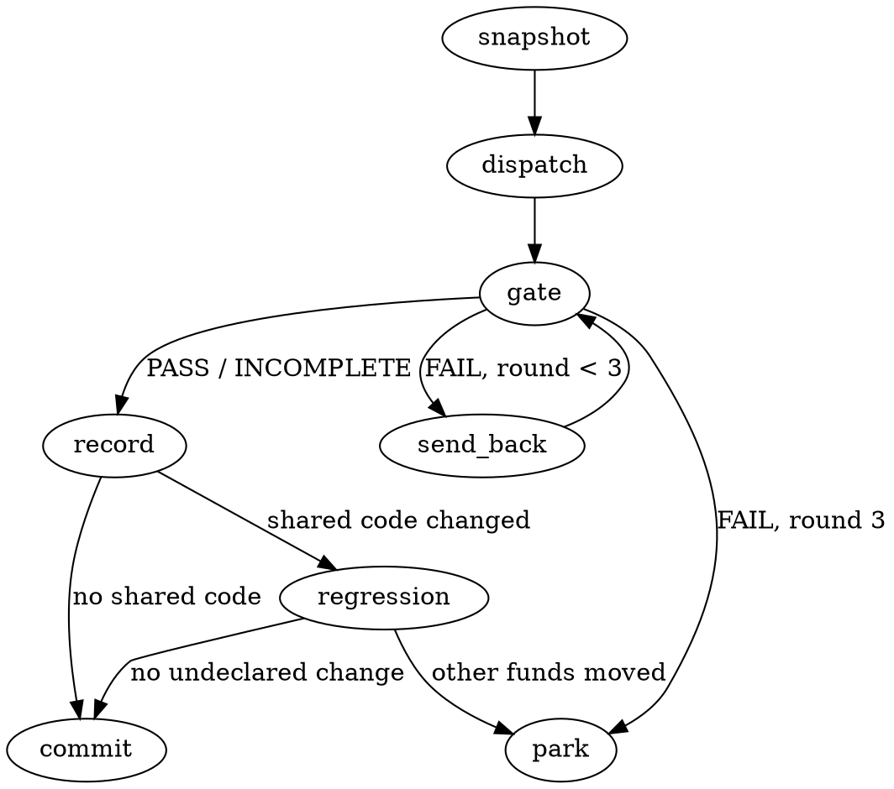

# v0.5 fund clearing (orchestrator)

You are the ORCHESTRATOR. One subagent owns one fund end to end (read, fix, build, propose). You
do not read filings or fix data yourself. You hand over the fund, run the mechanical gate on what
comes back, send failures back to the same agent, record the result, and move to the next fund.

**The unit of work is the fund, across all its quarters.** Causes sit at fund level (a wrapper
setting, a column, a member format); work pinned to one quarter does not carry forward.

## Hard rules (a violation stops the run; never work around one)

1. **One fund agent at a time, and nothing else writing in this working tree.** Builds, shared
   files and shared code are not safe in parallel. If `git log` or `git status` shows another
   session's work appearing during a run, stop and report.
2. **The gate decides.** `scripts/v05_evidence/fund_gate.py check` PASS, INCOMPLETE, FAIL or
   NEEDS_ORCHESTRATOR. Never
   edit the gate, a rule, a threshold, a check or the reasons list to change a verdict.
3. **Nobody in the loop accepts a new reason.** A disposition is accepted only by a check listed
   in `data/reference/accepted_disposition_reasons.json` (through `make_batch_dispositions.py`)
   or by the owner. Everything else is a proposal and stays outstanding.
4. Never: push, publish, download, build more than the funds in hand, write `data/output/` or
   `frontend/public/data/`, edit `AGENTS.md`, `git stash`.
5. Commit locally after each fund that passes (owner instruction 2026-10-13: unattended runs
   allowed). Stage only the files the gate lists as changed, plus the fund's report.
6. A zero is not "data correct". Say so in every report.

## Per fund

1. **Preflight.** No Python process running; `git status` read; last accepted sandbox for the
   fund found (`python scripts/v05_evidence/fund_ledger_latest.py <cik>`) and used as `BEFORE`.
   `ADD_QUARTER` is `2026-06-30` only for funds whose filings for it are on disk
   (`data/raw/filings/quarter_downloads/2026-06-30.csv`).
2. **Snapshot.** `python scripts/v05_evidence/fund_gate.py snapshot --out scratch/fund_runs/<cik>.snapshot.json`
3. **Dispatch** one general-purpose subagent. Its prompt is the whole of `fund-agent-brief.md`
   in this folder plus: `CIK`, `LABEL_PREFIX`, `BEFORE`, `ADD_QUARTER`,
   `REPORT = docs/investigations/v05_readings/reports/<cik10>.json`. Give it nothing else: no
   hypothesis about what is wrong.
4. **Gate** when it returns:
   `python scripts/v05_evidence/fund_gate.py check --label <label from report> --cik <cik> --report <REPORT> --before <BEFORE> --snapshot <snapshot>`
5. **FAIL:** send the gate's printed failures, verbatim, to the same agent (SendMessage, so it
   keeps its context). At most three gate rounds. Then
   `fund_gate.py park --snapshot <snapshot> --cik <cik>` and record the fund as parked with the
   last verdict. If `park` prints STOP, stop the whole run and report.
6. **NEEDS_ORCHESTRATOR:** the agent asks for a change it may not make (a check, the re-verifier,
   a rule). Read its evidence. A change to how a published value is VERIFIED (the re-verifier
   reading a new event) you make yourself, with a test, then re-snapshot, have the agent rebuild
   and gate again. A change to what counts as a FINDING or as ACCEPTED is the owner's: record
   the request, leave the finding outstanding, and continue. List every such change in the
   end-of-run report.
7. **PASS or INCOMPLETE with shared code changed** (the report says so, or the gate lists it):
   run the changed modules' tests now. If the change altered an EXISTING wrapper setting, find
   the other funds that use it (search `data/overrides/bdc_xbrl_wrappers/` for the key), rebuild
   them and run `regression_check.py`; a fund that MOVED without an explanation in the report
   parks this fund. A NEW setting is on for one fund: nothing else is rebuilt until the end of
   the run.
8. **Record:** set the fund's entry in `docs/investigations/v05_readings/accepted_sandboxes.json`
   to the sandbox that passed; append one entry to `docs/investigations/v05_decision_log.md` (next D-number: what
   was fixed, what is proposed, what is parked, gate verdict, sandbox label) and one line to the
   run table in `docs/investigations/v05_reading_backlog.md`. Commit.
9. Next fund.

**INCOMPLETE** means the build is clean but some findings have neither a fix nor a proposal. It
is recorded and committed like a pass, with the uncovered findings listed. It is not sent back
more than once for that reason.

## Order and scope

Largest first by 2026-03-31 published fair value: `python scripts/v05_evidence/cohort_by_size.py`.
`next <n>` means the next n funds in that order whose last gate verdict is not PASS.
A new quarter for a cleared fund is the same loop with `ADD_QUARTER`: record the first, untouched
reading (findings cleared by carry-forward against findings newly open) before any fix.

## End of run

1. **Regression, only if shared code changed during the run.** Rebuild the funds accepted before
   the run in sandboxes of at most ten (`build_fund.sh`, with `--add-quarter` where they have it)
   and run `python scripts/v05_evidence/regression_check.py <label>`. A fund that MOVED: find the
   commit that did it (one commit per fund), report it, and do not call the run clean.
2. **Owner decision ledger.** `python scripts/v05_evidence/owner_queue.py build`. The owner rules
   per reason: `owner_queue.py rule <reason key> accept|reject|more --words "<their words>"`.
   Only that command turns a proposal into an accepted disposition.

One report to the owner:

| Fund | Verdict | Findings | Outstanding | With a proposal | Quarters tying | Fixed | Parked |
|---|---|---|---|---|---|---|---|

Then: proposals grouped BY REASON across funds, one question per reason, unrelated one-offs kept
apart; errors the agents saw that no rule flagged; shared-code changes and what the regression
build showed; what was not run. Lead with what failed.

## Quick reference

| Need | Command |
|---|---|
| Fund order | `python scripts/v05_evidence/cohort_by_size.py` |
| Latest ledger of a fund | `python scripts/v05_evidence/fund_ledger_latest.py <cik> --rules` |
| Build | `bash scripts/v05_evidence/build_fund.sh <label> [--add-quarter D] <cik>` |
| Reasons accepted by check | `data/reference/accepted_disposition_reasons.json` |
| Gate | `python scripts/v05_evidence/fund_gate.py check ...` (verdict in `scratch/fund_sandbox/<label>/gate_<cik>.json`) |
| Field comparison | `python scripts/v05_evidence/holdings_field_diff.py <new> <old>` |
| Have accepted funds moved | `python scripts/v05_evidence/regression_check.py <label>` |
| Owner decisions | `python scripts/v05_evidence/owner_queue.py build | show [key] | rule ...` |
| Take a failed fund out | `python scripts/v05_evidence/fund_gate.py park --snapshot <file> --cik <cik>` |

## Red flags: stop and report

- You are about to read a filing or edit a wrapper yourself: that is the fund agent's work.
- "The gate is too strict here": report the case to the owner; do not loosen it.
- A fund "passes" with a total exception or a proposal you would not want to defend to the owner.
- Two builds or two fund agents at once.
- A count quoted without rebuilding: another session may have committed since. Check `git log`.
