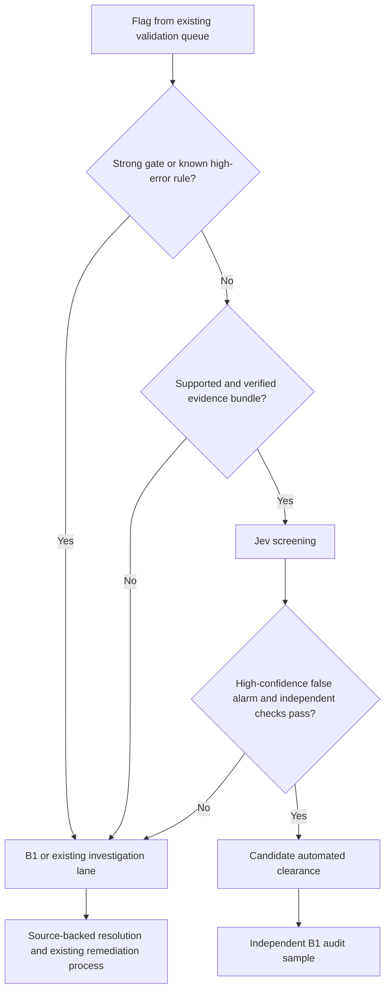

# Jev screening with B1 investigation

Date: 2026-10-03. Status: isolated implementation and development evaluation active;
production screening and automatic clearance are not enabled.

Execution is active in the isolated `.claude/worktrees/jev-screening-pilot`
worktree. See the [run log](05_run_log.md) for checkpoints and scope accounting.
Production code, data and queues remain outside this work.

The objective is **audited, correct position-level data**. The main opportunity is
to screen more weak-rule flags with the same B1 investigation budget. Jev handles
supported cases cheaply; B1 investigates difficult evidence, suspected errors,
low-confidence decisions and rules with a known high true-error rate.

## Read this folder

| Document | Purpose |
|---|---|
| [Routing and bundles](01_routing_and_bundles.md) | Routing precedence, evidence requirements and audit records |
| [Implementation and validation](02_implementation_and_validation.md) | Work packages, bounded experiments, metrics and rollout gates |
| [Experimental evidence](03_experimental_evidence.md) | What the existing tests establish, limitations and regression cases |
| [Eight-hour build and test plan](04_eight_hour_execution_plan.md) | Prioritised session schedule, deliverables, bounded evaluation and decision points |
| [Active run log](05_run_log.md) | Isolated implementation checkpoints, validation and remaining work |

## Proposed operating model

During calibration and shadow testing, candidate clearances do not suppress B1
work. After validation, B1 would routinely receive the escalation queue and an
independent sample of automated clearances. A screening clearance closes only the
specific weak flag on the specific data version; it does not certify a holding,
fund or quarter as audited.

## Decisions carried into this plan

- Start with C107 and X08; earn support for additional weak rules individually.
- Use 0.75 as a **pilot decision-confidence cutoff**, not a validated safety level.
  Calibrate source-selection confidence separately.
- Send incomplete/conflicting bundles and known high-error rules directly to B1.
- Send every Jev suspected error, ambiguity or failed evidence check to B1.
- Validate unfamiliar filers, changing layouts, later quarters and each supported
  filer/source type. Unsupported types remain unresolved.
- Keep every experiment below the v1 fund cohort. The proposed programme cap is
  16 explicitly named BDCs cumulatively, including previously tested funds; the
  next holdout tranche is at most four new funds and 40 natural flags.
- Preserve existing source reconciliation, quarter gates and remediation checks.
  Jev has no authority to edit holdings, approve fixes or refresh the baseline.

The isolated pilot now includes bundle construction, shadow routing, deterministic
comparators and frozen Jev observations. The two-fund blind holdout failed bundle
readiness (0/20) and was consumed for repairs; later results are development data.
Current work addresses source-context completeness and error controls. The
results do not justify production clearance. The owner has instructed execution
to continue until stopped in this chat; eight hours is a planning window, not an
automatic stop condition.
