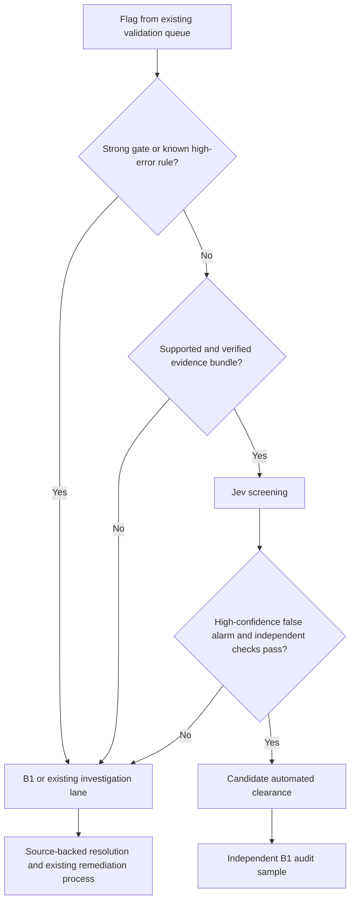

# Jev screening with B1 investigation

Date: 2026-10-03. Status: isolated implementation and development evaluation active;
production screening and automatic clearance are not enabled.

Start with the [current implementation and evidence map](17_current_state.md)
for the latest artifact versions and integration blockers.

Current checkpoint (2026-10-04): **39/67 bundles evidence-ready**, with 28 evidence
fallbacks. Three ready requests exceed the runner's token proxy cap, leaving
**36/67 within both evidence and size requirements**. **100/100 API calls used**, 42 unique natural flags called, zero
independently audited clearances and zero B1 suppression. Work continues offline.
The default C107/X08 policy admits 34 of those 36; two C104 cases require the
explicit development probe. These counts do not include a current model verdict
or independent clearance. A separate queue date/ID defect also blocks safe parent linkage; see [group accounting](13_rule_workload.md).
The inference estimate is about **$0.0664**; bundle maintenance and B1 review cost
are not measured. See the [interim assessment](06_interim_assessment.md) first.

A separate exploratory TCW source investigation found an existing dedup rule
retaining a sparse rollforward row and losing main-schedule cost detail, despite
matching FV audit totals. This was not found by Jev and is outside the frozen
67-case experiment. See [source-field retention](07_proxy_cost_evidence.md).

Execution is active in the isolated `.claude/worktrees/jev-screening-pilot`
worktree. See the [run log](05_run_log.md) for checkpoints and scope accounting.
Production code, data and queues remain outside this work.

A separate offline period-transfer check adds two C104 cases in an existing
fund's later filing. Both remain blocked by missing note associations. These
are additional development cases, not additions to the 67-case model benchmark;
no new model calls or independent audits were made.

The objective is **audited, correct position-level data**. The main opportunity is
to screen more weak-rule flags with the same B1 investigation budget. Jev handles
supported cases cheaply; B1 investigates difficult evidence, suspected errors,
low-confidence decisions and rules with a known high true-error rate.

## Read this folder

| Document | Purpose |
|---|---|
| [Routing and bundles](01_routing_and_bundles.md) | Routing precedence, evidence requirements and audit records |
| [Implementation and validation](02_implementation_and_validation.md) | Work packages, bounded experiments, metrics and rollout gates |
| [Experimental evidence](03_experimental_evidence.md) | What the existing tests establish, limitations and regression cases |
| [Eight-hour build and test plan](04_eight_hour_execution_plan.md) | Prioritised session schedule, deliverables, bounded evaluation and decision points |
| [Active run log](05_run_log.md) | Isolated implementation checkpoints, validation and remaining work |
| [Interim assessment](06_interim_assessment.md) | What the current results support, what they do not, and remaining experiments |
| [Proxy-cost evidence](07_proxy_cost_evidence.md) | Six real donor-lineage cases and why proxy costs need a separate B1 evidence contract |
| [Context size and cost](08_context_size_and_cost.md) | Four real filing payload comparisons, provider limits and measured-token cost estimate |
| [Independent review handoff](09_independent_review_handoff.md) | Source-first review inputs that withhold model answers and leave all audit checks unfinished |
| [Source-note stress test](10_source_note_stress.md) | Four synthetic error controls, including misleading instructions inside copied filing notes |
| [Remaining bundle work](11_remaining_bundle_work.md) | Evidence gaps, recovered note tables and section-scope drift |
| [Factual explanations](12_factual_explanations.md) | Source comparisons and routing reasons without invented model rationales |
| [Rule workload](13_rule_workload.md) | Wider coverage, review overlap and limits on potential savings |
| [Confidence sensitivity](14_confidence_sensitivity.md) | Separate experiment arms and why the cutoff remains uncalibrated |
| [Zero-value controls](15_zero_value_controls.md) | Final paired C104 test and complete 100-call accounting |
| [Missing issuer mechanism](16_missing_issuer_mechanism.md) | Three source-backed examples of upstream identity extraction failure and separate unresolved flags |
| [Current state](17_current_state.md) | Current artifacts, reusable components, optional diagnostics and remaining integration evidence |

## Proposed operating model

During calibration and shadow testing, candidate clearances do not suppress B1
work. After validation, B1 would routinely receive the escalation queue and an
independent sample of automated clearances. A screening clearance closes only the
specific weak flag on the specific data version; it does not certify a holding,
fund or quarter as audited.

## Decisions carried into this plan

- Start with C107 and X08; earn support for additional weak rules individually.
- Use 0.75 as a **pilot decision-confidence cutoff**, not a validated safety level.
  Calibrate source-selection confidence separately.
- Send incomplete/conflicting bundles and known high-error rules directly to B1.
- Send every Jev suspected error, ambiguity or failed evidence check to B1.
- Validate unfamiliar filers, changing layouts, later quarters and each supported
  filer/source type. Unsupported types remain unresolved.
- Keep every experiment below the v1 fund cohort. The proposed programme cap is
  16 explicitly named BDCs cumulatively, including previously tested funds; the
  next holdout tranche is at most four new funds and 40 natural flags.
- Preserve existing source reconciliation, quarter gates and remediation checks.
  Jev has no authority to edit holdings, approve fixes or refresh the baseline.

The isolated pilot now includes bundle construction, shadow routing, deterministic
comparators and frozen Jev observations. The two-fund blind holdout failed bundle
readiness (0/20) and was consumed for repairs; later results are development data.
Current work addresses source-context completeness and error controls. The
results do not justify production clearance. The owner has instructed execution
to continue until stopped in this chat; eight hours is a planning window, not an
automatic stop condition.
