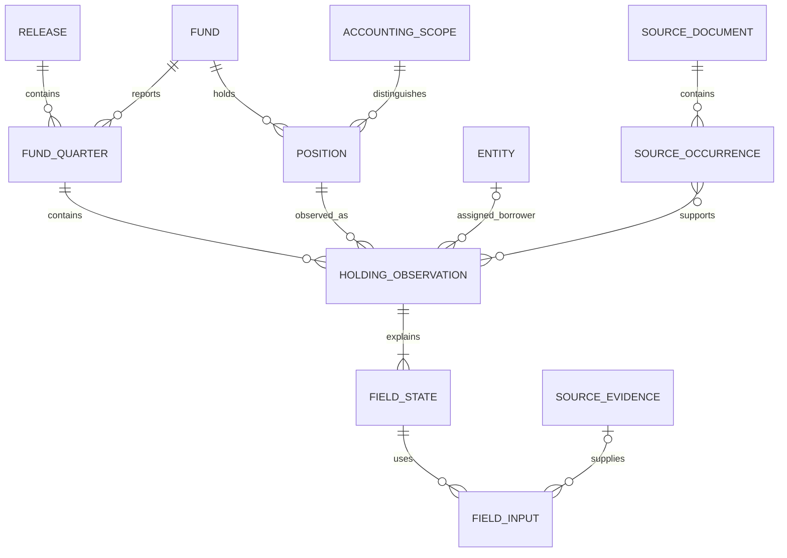
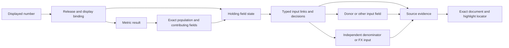

# Programme data model

Date: 2026-09-09. Version: 0.1. Status: proposed logical architecture implementing the resolved D01-D13 policies. This is a design, not a deployed schema or an acceptance verdict.

## 1. Recommendation and scope

Keep a wide, typed **holding observation** table as the analytical centre. Surround it with explicit records for reporting obligations, sources, persistent identities, evidence, accounting populations and releases. These supporting records explain a holding without changing its position-level grain.

The three central distinctions are:

- **Entity:** the borrower or investee company. One company can issue several instruments and appear in several funds.
- **Position:** one fund's continuing holding of a particular disclosed instrument or lot. Separate tranches, equity, warrants and facilities remain separate positions.
- **Observation:** what the fund discloses about that position on a particular date, as selected and interpreted in a particular data release.

For example, Fund A's first-lien loan to Acme in March and June is one position with two observations. Its Acme equity is another position. Fund B's Acme loan is a third position, even if it appears to be the same underlying facility. All three can link to one Acme entity. Cross-filer instrument identity is outside this programme.

The governed public population remains the 70-BDC cohort, with required observations from Q1-2023 through Q1-2026. The optional opening quarter and forward test retain their accepted roles. Public indices, group concentration products and ownership-adjusted look-through analytics are outside v1. Shared non-BDC ingestion and columns remain supported; this BDC model must not impose a CIK-only fund identity on N-PORT series.

This document refines the related-record sketch in the [target contract](programme_target_contract.md). Financial meaning remains governed there and in the [decision sheet](programme_decision_sheet.md); physical ordered schemas remain in [output_schemas.py](../../pipeline/output_schemas.py). It does not create a second editable field dictionary.

## 2. The model at a glance

| Record | One record represents | Why it exists |
|---|---|---|
| Fund | One BDC filer | Stable reporting identity and cohort membership |
| Fund-quarter | One fund's reporting obligation for one date in a release | Distinguishes an eligible missing quarter from a fund that had not started investing |
| Filing, document and source occurrence | A filing; an exact document version; a physical schedule row or addressable fact group | Preserves source selection, including rows with no tagged fair value |
| Holding observation | One retained position/lot for a fund, accounting scope and date | Carries the wide financial record used by analytics |
| Entity | One borrower or investee | Resolves names within and across filers without combining its instruments |
| Position | One continuing holding within a fund and accounting scope | Links observations across quarters without using rebuild-dependent IDs |
| Field state and inputs | The interpretation of one observation field and the evidence used | Separates disclosure, calculation, inference, correction and verification |
| Accounting scope and membership | A reporting owner/basis, and a row's relationship to a reference total | Distinguishes parent investments from JV underlying portfolios |
| Metric result and population | One reported or calculated metric, with its exact inputs | Gives portfolio analytics a reproducible denominator and click-through |
| Release and evaluation | One frozen candidate and the checks performed against it | Keeps holdings, identities, evidence and frontend data consistent |

The diagram shows the main cardinalities. Assignment and linking tables carry the detailed history described below.



The model is relational, but it does not require an application database, a graph database or one service per record. The subsequent [physical design](programme_physical_architecture.md) selects typed Parquet boundary artifacts and registry snapshots, DuckDB/dbt working models and single-coordinator JSON control records. Reviewed decisions retain their existing governed homes and immutable release snapshots.

## 3. Grain, keys and time

### Key conventions

`release_id` identifies a frozen, evaluated data snapshot. In the catalogue below, `R` abbreviates `release_id` and is part of every release-bound primary and foreign key. A join between two derived records must include `R`; joining on `row_id` or `position_id` alone can mix releases.

IDs are opaque `VARCHAR` values. They must not encode mutable amounts, normalized names, CSV row numbers or the global sort order. Source IDs are stable within an immutable document version and its structural coordinates. Durable entity/position IDs are assigned through registries. Existing IDs are retained where their guarantees hold; legacy IDs otherwise receive explicit mappings.

| Key | Meaning and stability |
|---|---|
| `cik` | Validated ten-digit BDC CIK, stored as text. Padding is a controlled normalization change, not numeric identity loss. |
| `document_id` | One exact source document version. Identity includes accession, document identity and content hash; a changed payload cannot silently reuse it. |
| `occurrence_id` | One physical row or addressable source fact group within that document, with a stable structural discriminator. |
| `row_id` | One normalized source-selected position/lot observation identity. Reused for corrections to the same source identity; a replacement source occurrence normally creates a new row ID. |
| `entity_id` | Durable borrower/investee identity. Names, aliases and classifications can change without renumbering it. |
| `position_id` | Durable continuity identity within one fund and accounting scope. An uncertain continuation receives a separate provisional identity until resolved. |
| `accounting_scope_id` | Durable reporting-owner and accounting-basis identity within the filer: for example, the parent's investment schedule versus a named JV's underlying schedule. |

The observation primary key is **`(R, row_id)`**. Its semantic grain is fund + report date + accounting scope + disclosed position/lot + selected source version. The primary key is not `(cik, date, borrower)` and not `(cik, date, description)`.

At most one observation can occupy `(R, cik, report_date, accounting_scope_id, position_id)`. To make this rule valid, concurrently disclosed lots have separate position IDs, even if they appear economically identical. When a later schedule combines or splits those lots, record a disclosure relationship and unresolved allocation where appropriate; do not collapse their historical values or assert an economic event without evidence. Multiple source presentation rows can support one observation through the source bridge.

Every retained observation has a position ID, including an explicitly unresolved singleton. The existence of an ID is not a claim that continuity was verified. Entity assignment may remain null with an explicit unresolved status. An unresolved accounting scope receives an explicit provisional scope record; it is not silently assigned to the parent scope.

Illustrative records in one release, using shortened IDs:

| `row_id` | Fund / accounting scope | Report date | `entity_id` | `position_id` | Instrument |
|---|---|---|---|---|---|
| O1 | A / parent | 2025-03-31 | Acme | P1 | First-lien loan |
| O2 | A / parent | 2025-06-30 | Acme | P1 | First-lien loan |
| O3 | A / parent | 2025-03-31 | Acme | P2 | Ordinary equity |
| O4 | B / parent | 2025-03-31 | Acme | P3 | First-lien loan |

This is four observations, three positions and one company. Summing O1 and O2 as a current portfolio would mix dates; merging O1 and O3 would erase instrument detail; giving O1 and O4 the same position ID would confuse different funds' holdings.

### Time conventions

- `report_date`: the economic observation date. A comparative December schedule in a March filing still has a December report date.
- `filing_date` / `filed_at`: when the source was filed, separate from the filing's main reporting period.
- `effective_from` / `effective_to`: dated validity of an entity alias, group relationship, classification or rule; intervals use `[from, to)`.
- `recorded_at`: when this system recorded a decision, in UTC.
- `release.created_at`: when the data snapshot was assembled. Later releases can correct earlier quarters.

This supports the accepted **latest-best historical series with reproducible older releases**. It does not introduce an as-known-at-cutoff product. A later source may revise a historical value where policy permits; its filing date and selection rationale stay visible.

### Types and nulls

Holdings retain the existing physical types and ten proposed additions in the target contract. Dates are `DATE`, IDs and enums `VARCHAR`, flags `BOOLEAN`, counts `BIGINT`, and current financial measures `DOUBLE`. Supporting audit records also require UTC timestamps, persisted as canonical ISO-8601 text until a physical timestamp migration is specified. Variable metadata is structured, schema-validated content, not unconstrained blobs replacing core keys.

Source numeric tokens, scale, sign, unit and precision are retained losslessly alongside normalized values. Public reductions use the target contract's shared decimal serialization and aggregation convention. A source dash, an absent tag and a reported numeric zero are distinct states. Negative FV/cost is permitted when supported by the source. Nulls require a field state; they are not silently replaced with zero.

## 4. Fund, source and observation relations

The catalogue specifies required identity and substantive attributes. Existing financial columns remain defined in the target contract and crosswalk rather than being repeated here. A named foreign key must resolve; optional foreign keys are explicitly nullable.

| Relation and primary key | Required attributes and links | Rules |
|---|---|---|
| `fund (cik)` | Stable BDC reporting identity; source-backed identifiers | Names and operating status are versioned attributes. A corporate name change alone does not create a new fund. |
| `cohort_member (cohort_version, cik)` | Cohort manifest hash, membership reason and validity | Membership is pinned by a release; missing output cannot remove a cohort member. |
| `fund_quarter (R, cik, report_date)` | Cohort version; role `required/opening/forward_test/auxiliary`; eligibility, operating status, source availability, output status; decision references | Eligibility and coverage are separate. States include eligible, pre-investment and unresolved; empty is only confirmed with evidence. The required frame starts with 910 obligations, not only the rows successfully extracted. |
| `filing (accession_number)` | `cik`, form, filing date/time when available, primary report date, amendment metadata | An accession is a filing container, not a unique document or observation date. |
| `source_document (document_id)` | Filing FK; document name, content hash, media type, cache locator, source URL if known | Immutable bytes. Cache paths locate content but are not its identity. One accession can have HTML, XML and exhibits. |
| `source_context (document_id, context_id)` | Raw entity identifier; instant or start/end dates; full expanded-name dimensions and members | XBRL context IDs are document-scoped. Preserve dimension paths before interpretation. Context alone does not locate a particular number. |
| `source_unit (document_id, unit_id)` | Expanded-name numerator/denominator measures; raw unit representation | Unit IDs are document-scoped. Printed currency and inline units can disagree; retain both. |
| `source_occurrence (occurrence_id)` | Document FK; schedule/table locator; row or fact-group locator; context references; raw labels; source order | Preserve candidate positions without FV tags, source nils, subtotals and presentation repeats. It is a source roster, not already the final holdings population. |
| `source_evidence (evidence_id)` | Document FK; exact locator; optional occurrence/context/unit FKs; evidence kind; raw text/numeric token, sign/scale/precision/nil where applicable; reader version | Evidence kinds include tagged fact, visible cell and passage. Document/context/unit references must agree. A copied number without a locator is not source evidence. |
| `source_selection (R, selection_id)` | Fund-quarter FK; purpose and scope; chosen document set; precedence-policy version and decision | One active selection per fund-quarter/purpose/scope. Separate holdings, NAV, lifecycle and supplementary evidence purposes. Latest-best selection follows explicit source policy before assessing candidate extraction success. |
| `source_selection_member (R, selection_id, document_id)` | Role, selected/alternative disposition and reason; covered observation dates/schedules | Allows multiple documents and explicit alternatives. It must not imply that every document's main report date equals the observation date. |
| `occurrence_disposition (R, occurrence_id)` | Selected-scope mapping; retained/excluded/repeated/unresolved status, reason and decision reference | Reconcile every occurrence in an assessed selected schedule to a disposition. Unresolved rows remain in the issue population. A source-reader roster alone is not independent completeness gold. |
| `holding_observation (R, row_id)` | Fund-quarter FK; accounting scope; position and entity assignment links; source selection; record kind; all typed holdings fields | Final financial truth for this release. Distinct disclosed instruments/lots remain distinct. Subtotals belong to source dispositions, not ordinary position observations. |
| `holding_source (R, row_id, occurrence_id, role)` | Holding and occurrence FKs; primary/continuation/supplement/repeat role; optional decomposition decision | Many-to-many bridge. Every holding has a primary source occurrence or an explicit source-location gap. One physical row produces several holdings only with evidence-backed decomposition. |

`source_occurrence` handles both visible schedule rows and pure-XBRL groups. When HTML is available, a row with no tagged FV must still be representable. The raw context/dimension signature is a candidate discriminator, not proof that two groups are economically different or identical.

`record_kind` describes retained records as `direct_position`, `underlying_position` or `unresolved`. It is a presentation/accounting role, separate from instrument type and accounting-scope identity. Cash and facilities retain their instrument classifications. A JV underlying loan can therefore remain both `underlying_position` and a first-lien loan without competing classifications.

If a filing is selected but extraction fails, retain that selection and the gap. Any permitted alternative-source recovery requires an explicit policy and decision; choosing whichever filing yields the most plausible output would bias completeness and reconciliation.

## 5. Entity and position relations

| Relation and primary key | Required attributes and links | Rules |
|---|---|---|
| `entity (entity_id)` | Registry identity; entity type; creation decision | Borrower/investee identity only. A fund or JV can also be an entity where it is an investee/reporting owner; this does not merge its roles. |
| `entity_alias (alias_id)` | Entity FK; alias/identifier type and value; source and effective dates; decision | Aliases and company names are not globally unique. LEI/CUSIP/ISIN meanings must match the entity or instrument they actually identify. |
| `entity_assignment (R, row_id)` | Nullable entity FK; resolved/provisional/unresolved status; decision and method; confidence meaning when supplied | One selected assignment per observation per release. Conflicting candidates stay in decision evidence. The holdings `entity_id` is its materialized projection. |
| `entity_relationship (relationship_id)` | Subject/object entity FKs; relationship kind; effective dates; evidence and decision | Parent/group relationships are dated edges. Acquisition or common ownership does not justify merging two borrower identities. A release uses a pinned relationship snapshot. |
| `position (position_id)` | Fund and accounting-scope FKs; creation decision; registry status | Fixed ownership scope. Do not persist a mutable company name or financial amount as its identity. First observed date is derived from release members, not treated as origination. |
| `position_assignment (R, row_id)` | Position FK; selected match decision; continuity status | One assignment per observation. Projection into the wide table occurs before cost derivation and finalization. |
| `position_link (R, link_id)` | Earlier/later observation FKs; link kind; proposed/accepted/rejected/unresolved disposition; evidence and decision | Same-fund and compatible-scope rules apply to continuity. Candidate matching edges can be many-to-many; accepted ordinary continuation is one-to-one between the chosen observation dates. Skipped-quarter links record the gap. |
| `identity_revision (revision_id)` | Identity kind; correction/retirement/split/merge reason; decision; explicit member records | Revisions use a related `(revision_id, side, identity_id)` member relation, typed separately for entity and position IDs. Support one-to-many corrections; do not force every split into a single surviving-ID alias. Release snapshots pin the revisions they use. |

The registry identifies records; the matcher supplies evidence for continuity. Preserve the existing contested-assignment and maturity-veto machinery where it satisfies the contract. The opt-in [position registry](../../pipeline/position_id_registry.py) is a starting point, not proof that production IDs are already durable.

An unmatched March-to-June observation is not automatically a new origination, sale or economic exit. It can reflect missing extraction, renamed disclosure, an ambiguous facility or a true investment change. Keep these outcomes distinguishable. Accepted position links and assignments must agree: ordinary continuation shares a position ID; a documented split/combination uses distinct IDs and explicit relationships. Do not allocate historical FV across successor positions without a supported allocation.

Registry inputs and candidate allocations are pinned release artifacts. Trial runs cannot mutate the accepted registry. Retrying a candidate with the same inputs must reuse its allocations; adding an older quarter or an unrelated fund must not renumber existing identities. Incorrect prior assignments can change through a recorded revision in a new release.

## 6. Accounting scope and reconciliation

Accounting scope describes **whose holdings and which accounting basis a source schedule represents**. It is separate from the borrower entity and instrument classification. `is_subsidiary`, `axis_profile` and `jv_subsidiary` remain useful compatibility signals, but none is a complete scope key.

| Relation and primary key | Required attributes and links | Rules |
|---|---|---|
| `accounting_scope (accounting_scope_id)` | Reporting CIK; owner identity or explicit unresolved owner; scope kind and basis; source-backed definition | Parent investment portfolio, named JV underlying portfolio and other subsidiary scopes are distinct. Raw dimensions map to this identity through release decisions. |
| `scope_assignment (R, occurrence_id)` | Accounting-scope FK; decision; mapping status | Records the interpretation of a source row/table. An unresolved mapping remains measurable and cannot silently qualify for a known comparable anchor. |
| `holding_relationship (R, relationship_id)` | Parent and underlying holding FKs; relationship kind; evidence/decision; optional reported ownership | Both endpoints belong to the same release and compatible dates. Missing parent observations remain explicit unresolved-link cases. Never derive ownership from FV ratios. |
| `reconciliation_anchor (R, anchor_id)` | Fund-quarter and accounting-scope FKs; independent metric result; primary/supplementary role; basis/currency/date; comparability status and decision | At most one selected primary B3 anchor per fund-quarter. Other totals remain supplementary. Missing or incomparable anchors remain gaps, not a total reconstructed from candidate holdings. |
| `anchor_member (R, anchor_id, row_id)` | Anchor and holding FKs; included/excluded/unknown disposition; reason and decision | Defines each assessed row's treatment against that anchor. Complete membership covers the assessed fund-quarter scope, including exclusions and unresolved cases. |

There are **two separately named populations**:

1. The public portfolio population follows the accepted holdings/cohort contract. Retained JV/subsidiary rows remain retained; all index classifications participate. A source-conservation exclusion does not authorize a public row deletion.
2. The reconciliation population contains the observations comparable with a particular source total. Subsidiary underlying rows are excluded where the parent anchor already includes the parent's interest, under the existing retain-and-flag rule.

Their totals can differ for an explained accounting reason. Homepage FV and public instrument/industry charts must nevertheless agree exactly with the same public holdings population. This model does not authorize changing that public basis to a reconciled overlay or an ownership-adjusted total.

The [pilot's Sentinel case](programme_measurement_pilot_2026-09-09.md) shows why the distinction is required:

| Observation | Reporting owner/scope | Instrument | Cost / FV, USD |
|---|---|---|---|
| Sentinel Buyer Corp. 2, December 2025 | Parent fund portfolio | Term loan | 255,050,000 / 254,664,000 |
| Sentinel Buyer Corp. 2, December 2025 | ULTRA III JV underlying portfolio | Delayed draw | -190,000 / -188,000 |

Same borrower wording and date do not identify the same holding. These have separate scope, source occurrence, position and observation keys. Source-labelled evaluation must use those distinctions too.

## 7. Field evidence, corrections and enrichment

Keep financial values in typed holding columns. Use a field-level metadata relation to describe how each value was obtained. This avoids turning ordinary holdings queries into an attribute/value pivot while supporting detailed lineage.

### Four independent evidence axes

| Axis | Allowed conceptual states | Example |
|---|---|---|
| Availability | `present`, `not_disclosed`, `not_applicable`, `unresolved`, `missing_source`, `failed_extraction` | Cost absent from the schedule differs from a cost extraction failure. |
| Derivation | `reported`, `normalized`, `calculated`, `inferred`, `approved_default`; null with reason when no value exists | Reported FV; scale-normalized FV; calculated FV cost proxy; inferred sector; assumed USD. |
| Correction | Zero or more versioned correction events | A currency interpretation was corrected with source support. |
| Verification | `not_checked`, `source_matched`, `independently_reviewed`, `disputed`, `not_assessable` | An independently reviewed inference remains an inference. |

Availability describes the effective field value; input evidence retains whether the original disclosure was absent. Thus a permitted proxy can have `availability=present`, `derivation=calculated`, `method=first_observed_fv_proxy`, with an input documenting absent reported cost. `cost_reported` remains `not_disclosed`. The four axes must not be compressed into one label such as "verified".

| Relation and primary key | Required attributes and links | Rules |
|---|---|---|
| `field_state (R, row_id, field_name)` | Holding FK; availability/derivation/verification; method version; effective unit/basis; selected decision; value hash | One logical state for every field governed by the released contract, including missing fields. Values are read from their authoritative typed column; the hash detects mismatched metadata. |
| `field_input (R, row_id, field_name, input_ordinal)` | Target field-state FK; role; one typed input FK | Exactly one input type: source evidence, another same-release field state, same-release metric result, immutable FX quote or admitted decision. Input roles include reported fact, interpretation, donor, FX, denominator and inference evidence. |
| `decision (decision_id)` | Immutable kind/method/version, scope and effective dates, rationale, input hashes, actor/time, evidence links, confidence definition when used | Covers deterministic interpretation, correction and model proposals without asserting they are approved. Historical missing model/prompt metadata is marked unavailable. |
| `decision_review (review_id)` | Decision FK; review/verification action, actor, time and evidence | Append review actions. Preserve existing proposal/verify/promote roles and authority. A worker's own confidence is not independent verification. |
| `release_decision (R, decision_id)` | Pinned decision hash and applicable review/promotion reference; application scope | Only decisions eligible under the existing governance route affect finalized values. Filename location or a `.proposed` file does not grant promotion. |
| `correction_application (R, application_id)` | Decision FK; target holding/field; before/after value and unit; application order; validation evidence | Immutable audit event. Before/after copies are history, not competing final values. Same-release order must match the production and verifier precedence contract. |
| `enrichment_assignment (R, assignment_id)` | Explicit entity/fund/observation subject; field/taxonomy version and level; effective dates; decision and input evidence | Subject FKs are typed and mutually exclusive. Different companies or different dates cannot inherit an assignment merely because names match. |
| `taxonomy_term (taxonomy_version, code)` | Level, display name and nullable parent-code FK within the same version | Reference projection of the existing taxonomy source. Sector/sub-industry assignments must resolve to the declared level; historical releases retain the taxonomy version they used. |
| `fx_quote (fx_quote_id)` | Base/quote currency, conversion date/convention, rate, source evidence/provider/version | Immutable reference input. The later units/FX contract defines provider/date/fallback policy; real historical quote coverage and integration remain to be established. |
| `holding_status (R, row_id)` | Strict current PIK status and related evidence; status-method versions | Typed extension for existing status artifacts. Terms, current payment/accrual and stress-amendment evidence remain distinct; absence of a flag is not confirmed absence of the condition. |

Implement `field_input` with explicit nullable FK columns and an exactly-one-input check, or equivalent typed child relations. Do not use an unchecked `(object_type, object_id)` string pair. All derived inputs resolve within the same release; immutable source evidence, decisions and FX records are admitted through its pinned input manifest. Reject cycles in field/metric dependencies.

Field names resolve through the pinned schema contract, including qualified extension names such as `holding_status.pik_current_status`. Generate that registry from authoritative schemas; do not maintain another independent editable list. An extension value stays in its typed status artifact and participates in the same evidence interface.

Release admission does not add human review to every deterministic calculation. Eligibility for ordinary transforms comes from the pinned code/rule versions and accepted policy. Agent-authored corrections and enrichment decisions follow their applicable existing verification/promotion route; the record makes that route and status explicit.

Corrections or model versions do not mutate old releases. A source-currency dispute can be resolved in the next release with a new interpretation decision while retaining the original printed cell and inline unit. An inference that is not assessable remains visible as such. Existing incomplete provenance can be represented honestly, but cannot count as complete click-through coverage.

### Inferred GICS sector

Entity-level business classification is shared only where the entity assignment and effective dates support it. The enrichment record stores taxonomy version/level, input documents, model/provider identifier, prompt/config version, output, rationale, time and review status. A sector assignment can exist without a sub-industry assignment. A fund's strategy classification has a fund subject and cannot accidentally become its borrowers' industry.

The holding's `gics_sector` is a release-bound projection of the applicable assignment. If the company has not explicitly disclosed a GICS code, business descriptions can support an inference or deterministic mapping; they do not make the result a reported GICS value. Changed entity resolution must invalidate/re-evaluate any sector assignment tied to the previous entity.

### First-observed-FV cost proxy

Select the earliest eligible FV observation for the **same established position** under the release's latest-best history and documented source precedence. Derive cost only after position assignment. Require source cost to be absent: reported zero wins, and invalid disclosed cost or pending currency conversion does not qualify as absence.

Record a field input to the donor's `fair_value`, the absent `cost_reported` state and the policy decision. A donor FV of zero is valid. An uncertain cross-quarter match cannot supply a donor from another provisional position. Matching must not depend on cost values calculated from its own proposed links; use independent reported inputs during matching to avoid circular support.

Donor observations outside required history must be admitted into the same release with `fund_quarter.role=auxiliary`, with source selection and evidence. This makes earlier cached history usable without widening the public/acceptance population or creating a hidden previous-run dependency. No donor is read from an unpinned older CSV.

## 8. Metrics, populations and click-through

| Relation and primary key | Required attributes and links | Rules |
|---|---|---|
| `metric_definition (metric_definition_id, version)` | Meaning, unit, reported/calculated kind, formula, scope/basis, denominator, null and rounding rules | Separate reported NAV, calculated NAV exposure and portfolio weight definitions. Instant and duration metrics have explicit period semantics. |
| `population (R, population_id)` | Versioned selector; fund/cohort/date/scope constraints; member manifest hash and counts | Exact reproducible membership. Public selectors exclude auxiliary/opening/forward roles where appropriate, not unknown classifications or valid negative values. |
| `population_member (R, population_id, row_id)` | Population and observation FKs | One membership per row; materialize or store a verifiable immutable selector/result. Do not duplicate holdings values in each membership. |
| `metric_result (R, metric_id)` | Definition/version FK; subject fund/cohort/scope; report date or duration; value/unit; availability/derivation/verification; decision/correction references; coverage and denominator | `metric_id` identifies the result instance. The definition, subject, period, scope and parameter hash must also be unique within a release. |
| `metric_input (R, metric_id, input_ordinal)` | Target metric FK; role; exactly one typed evidence/field/metric/population/FX/decision input | Population inputs name the contributing fields and operation. A source-reported NAV uses independent source evidence; a portfolio sum uses holdings membership. Inputs form an acyclic graph with field inputs. |
| `display_binding (display_binding_version, display_key)` | Frontend display identifier; metric definition or holding field; formatting/unit rule; drill-through kind | The release pins the binding version. A display cannot privately calculate an alternative denominator or label inferred data as reported. |

For public portfolio FV, one shared population selects the cohort's retained holdings for the public reporting quarter across all classifications. The headline is its FV sum. Instrument and industry groups partition that exact membership, with an explicit unknown/unclassified bucket. No deduplication, matched-only subset, scaling or reconciled replacement is introduced during export.

For other metrics, eligible rows and weights may differ legitimately but must be named: for example, a weighted average spread needs a defined spread/weight population and missing-value coverage. Missing FV remains a coverage issue even when the sum of known FV agrees with the source total. Currency conversion and rounding occur under the shared contract before public aggregation; no chart-specific rounding adjustment changes its economic population.

The evidence resolver has two entry points:

```text
observation value: (release_id, row_id, field_name)
aggregate value:   (release_id, metric_id)
```

It returns the value, unit, basis, four-axis status, method/decisions and immediate input links. Direct source inputs open the exact cached document and highlight the number/cell/passage. Calculations expose their contributing fields and denominator. Inferences show their method and supporting passages. Aggregates open a paginated contributor list whose count and total reproduce the result; a metric with thousands of contributors does not pretend to have one source citation.



Locator representation is media-specific: inline fact ID plus row/cell context for iXBRL; DOM/table/cell coordinates and quote verification for HTML; page plus bounding rectangle/text anchor if PDF support is later added. Every locator binds to the document hash and reader/locator version. Repeated identical numbers require row/column/context disambiguation. A stale or missing locator returns an explicit unavailable reason, not an arbitrary highlight.

HTML/iXBRL is the accepted initial viewing path. Arelle belongs in the extraction/validation/viewer evaluation, not as the identity or lineage store. PDF can use the same document/evidence interfaces later; a PDF viewer is not a new requirement for this stage of the programme.

## 9. Release, quality and recovery records

| Relation and primary key | Required attributes and links | Rules |
|---|---|---|
| `release (R)` | Parent release; creation time; code and dirty-patch identity; cohort/schema/decision/metric/display versions; source/config/rule/registry manifests | Metadata is frozen when the candidate is sealed. Subsequent changed inputs or outputs require a new candidate identity. A Git hash alone is insufficient for a dirty working tree. |
| `release_artifact (R, artifact_key)` | Relative path, role, content hash, schema version, row count, producing stage; input/output registry roles | Enforces compatible holdings, identity, PIK, evidence, metrics and export snapshots. CSV and Parquet values must correspond. |
| `stage_checkpoint (R, stage_key, attempt)` | Stage/version, input hashes, state, output manifest, failure details, start/end time | Resume completed work only when all declared inputs and versions match. Incomplete files are not completed checkpoints. Candidate-local staging permits atomic replacement of each completed bundle. |
| `release_event (R, event_id)` | Event type, actor, time, evaluation/approval reference | Append build/evaluation/ready-for-review/owner-approval/publication events. Programme success is ready for owner approval, not automatic publication. |
| `validation_result (R, check_id, evaluation_id)` | Check/version; benchmark and threshold versions; evaluated population; numerator/denominator/counts; status; uncertainty/assessability; evidence artifact hash | Structural invariants and measured accuracy remain distinct. Pass/fail is reproducible against pinned definitions, not a mutable dashboard label. |
| `quality_issue (R, issue_id)` | Check/decision reference; precise fund-quarter/row/field/source location; severity, reason, disposition and evidence | Exceptions remain countable with their affected population/FV basis. Unresolved evidence is a legitimate result; it must not be silently suppressed to pass. |

A benchmark manifest identifies independently governed source/identity/classification labels and their exposure/approval status. Evaluators read it; remediation workers do not obtain authority to edit held-out truth by writing a `decision`. Development examples and previously exposed gold remain labelled as such. Final numerical thresholds still require D12 calibration and approval; this design does not make the pilot proposal live.

The dependency order supported by the model is:

```text
pinned cached sources + cohort + rules + registry inputs
    -> source roster, selection and accounting scopes
    -> typed normalization and promoted source/field corrections
    -> entity and position assignments
    -> identity-dependent enrichment/cost and calculated observation fields
    -> one finalized holdings snapshot + related evidence/status records
    -> portfolio metrics and independent data validation
    -> complete candidate export and delivery validation
    -> ready for owner approval
```

Independent source financials such as reported NAV can be prepared upstream and supplied to normalization/metrics. Source-derived classification need not wait for position matching; classification that depends on entity identity must wait for its entity assignment. This is a dependency model, not a requirement to serialize independent work.

Finalization is one coordinated writer. Identity assignment must not rewrite the CSV after a Parquet companion or frontend export has already been generated. Candidate files are staged in an isolated directory, sealed by a manifest and evaluated together. A public release pointer changes only to a complete approved bundle. Registry adoption follows the same accepted release pointer, so a failed trial cannot alter the IDs used by the next accepted build.

Checkpoints make work recoverable after process loss or usage interruption; they are not a promise about whether an agent process will be paused or killed. Recovery reloads the persisted stage/task state and verifies hashes before continuing. The [processing architecture](programme_processing_architecture.md) defines the stage interfaces, invalidation and two data/delivery acceptance boundaries; the [physical design](programme_physical_architecture.md) specifies storage, allocation, commit records and adoption mechanics. Runtime proofs remain necessary.

## 10. Structural invariants and acceptance cases

These are schema/relational requirements, separate from the numerical working targets and empirical calibration. A product candidate cannot be ready for approval if its own keys, projections or release joins violate them. A source or numerical gap is a recorded quality issue evaluated under the relevant acceptance criterion; a diagnostic package can still present that failure for review.

| ID | Invariant |
|---|---|
| M01 | All primary keys are unique; typed FKs resolve; derived joins include the release. No artifact mixes registry or evidence generations. |
| M02 | Every required cohort-quarter obligation exists independently of extracted row presence. Lifecycle exclusions require evidence and remain distinct from missing sources/output. |
| M03 | Each retained disclosed instrument/lot has one observation and one position assignment; concurrent lots cannot share a position ID. Subtotals/repeats have explicit source dispositions. |
| M04 | Ordinary position continuity stays within the same fund and compatible accounting scope. Accepted links agree with assignments; group ownership or name similarity alone does not merge entities or positions. |
| M05 | Registry IDs survive source-order changes, rebuilds and unrelated additions. Corrections, splits and retirements are versioned; a failed trial cannot mutate accepted state. |
| M06 | Every governed holding field has a state consistent with its actual typed value. Populated values have a derivation; missing values have a reason. Numeric zero, null, source dash and negative values retain their meanings. |
| M07 | Every asserted evidence link resolves to the correct document/version. Typed field/metric inputs form an acyclic graph; missing provenance is explicit and excluded from successful citation coverage. |
| M08 | Cost proxies use an evidenced same-position FV donor only when reported cost is absent. Reported zero takes precedence; uncertain identity, invalid disclosed cost and pending FX are not permission to borrow a value. |
| M09 | No cross-currency public sum, unsupported rate completion, fabricated precise maturity or relabelling of inferred GICS as reported. Rates/cost/currency/status follow the target contract. |
| M10 | Anchor membership and public membership are separate, explicit and reproducible. An anchor is independent of candidate holdings; primary anchor selection is unique or explicitly missing. |
| M11 | Headline FV and instrument/industry breakdowns exactly reconcile to the same public holdings population and declared arithmetic convention. Other metrics declare their eligible population, denominator and missingness coverage. |
| M12 | Proposals cannot affect final values without the applicable promotion route. Final validation occurs after every value/identity-changing step; no later writer changes the sealed release. |

Implementation should verify these concrete cases using existing fixtures where possible:

| Case | Required result |
|---|---|
| Acme loan/equity, two funds, two quarters | One resolved company can support three separate positions and multiple observations. Borrower grouping is an analytic operation, never base-table deduplication. |
| Bain June 2023 ordinary and preferred equity | Two observations, not one company row; both costs remain reported even if equal to FV. |
| Lord Abbett September 2024 untagged FV dashes | All 33 disclosed loans/facilities remain in the source roster; the six dash rows retain unresolved numeric states. Exact known-FV reconciliation does not prove row coverage. |
| Sentinel parent loan versus JV delayed draw | Distinct scope/instrument keys prevent the wrong join, even with identical borrower wording and date. Negative source values remain eligible values. |
| Esdec printed EUR principal versus inline USD | Preserve both source representations and an interpretation decision. USD FV/cost is not converted merely because principal is EUR. |
| Paragon displayed 3.38% versus contradictory inline scaling | Retain scale and display evidence; tag-copy agreement alone is not a verified coupon interpretation. |
| Corrected filing and a legitimate comparative period | Replacement source gets explicit new observation identity; established position continuity can persist. Observation date remains the comparative date. Old releases remain reproducible. |
| First observed FV is zero, with later absent cost | Zero can be the documented donor; do not replace it with a later nonzero FV. A missing/unresolved identity cannot borrow a company peer's value. |
| Entity split after an earlier mistaken merge | New release records the revision and rebinds dependent sector assignments; earlier release remains intact. No single-target alias hides the split. |
| Crash after registry allocation but before export | Retry reuses the isolated candidate allocation; accepted registry/output remains unchanged. A stale checkpoint cannot mix old evidence with new holdings. |

These are design cases, not newly executed tests or a claim that the current pipeline passes them. Pilot cases are development evidence, not fresh held-out acceptance labels.

## 11. Reuse and migration boundary

| Existing asset | Target role | Necessary change |
|---|---|---|
| `private_markets_holdings.csv`, typed companion, `unified_holdings.py` | Wide observation projection and finalization | Preserve existing financial columns plus the ten separately proposed additions. Bind related metadata to the same release. |
| Wrappers, grammars, XBRL/HTML extraction and cache | Source documents, occurrences, facts and deterministic interpretations | Expose durable locators, units, dimensions, absent-tag rows and dispositions; preserve per-CIK mechanisms. |
| Entity resolver, lookup and overrides | Entity registry and assignments | Version assignments/aliases/revisions; prevent post-finalization writes and inferred group merges. |
| Position matcher, match artifacts and opt-in registry | Position registry, assignments and links | Validate collisions/lots/revisions and candidate-local registry persistence; stop using rebuild-local IDs as durable keys. |
| Provenance ledger, correction caches and verifier/promoter | Decisions, reviews, correction applications and field inputs | Adapt existing schemas/vocabulary with explicit mappings; align verifier and production precedence. |
| GICS/classification producers | Typed enrichment assignments | Distinguish subject, taxonomy level, inference method and evidence. Legacy metadata gaps stay explicit. |
| Fund financials, reconciliation and subsidiary flags | Independent metrics, scopes, anchors and memberships | Select comparable accounting bases and complete membership/disposition records. |
| PIK status and terms-transition artifacts | Release-bound holding status and linked metrics | Preserve different PIK meanings; attach durable observation/position identity and source evidence. |
| Quarter acceptance, source/match benchmarks, attestations | Versioned validation results and benchmark manifests | Reuse independent evaluators; add missing invariants and reference coverage without changing live thresholds here. |
| Frontend export and static JSON | Metric/display projections and evidence resolver indexes | Consume a single evaluated candidate, carry release identity, and stop independent denominator/meaning overrides. |

The internal logical observation includes scope/selection/release keys. This **does not silently add extra columns beyond the ten additions already proposed for the shared CSV**. These links initially live in a one-to-one observation metadata companion keyed by `row_id` within a manifest-bound release. Existing `entity_id`/`position_id` columns project the selected assignment. If later exposing more keys in the CSV is useful, do it through an explicit physical schema version.

CSV remains canonical during the current migration stage. The full shared artifact can still contain non-BDC rows; this programme's release manifest names both the shared artifact and the governed BDC subset. Public metrics consume the exact cohort/date selection from that artifact. All governed sidecars must match its BDC observations. A separate, independently editable "new holdings truth" is not introduced.

The [physical design](programme_physical_architecture.md) maps logical relations to typed files, dbt views/tables and immutable registry snapshots, retaining single-file core artifacts initially. The [implementation plan](programme_implementation_plan.md) assigns enforceable checks and retirement of old writers to bounded packages. These choices support the contracts and existing scale without creating a service for each record type.

In particular, field metadata can reach tens of millions of logical records. Store shared method/state profiles and explicit exceptions where their expansion is exact; expose a complete `field_state` view rather than duplicating identical metadata for every not-applicable field. Share immutable documents, evidence and decisions across releases, and store populations once rather than embedding the same contributor list in every metric. Resolve contributor pages on demand. Use DuckDB/dbt set operations and typed storage; a Python object per field or a full lineage graph in every frontend JSON payload is unsuitable for this scale.

## 12. What is settled and what remains

This draft supplies a concrete logical design for observation grain, keys, time, company/position identity, accounting scopes, field-level evidence, enriched values, aggregate provenance and release membership. It incorporates the measured source failures without reopening D01-D13.

The [processing architecture](programme_processing_architecture.md) assigns transformations to Python, evaluated Arelle interfaces, dbt/DuckDB and existing reviewed-agent interfaces. The [physical design](programme_physical_architecture.md) maps stages to artifacts, registry persistence and recovery/adoption mechanics. The [implementation plan](programme_implementation_plan.md) adds preparation work, eleven engineering packages, completion evidence and execution controls. These are proposed designs, not deployed capabilities.

The later [units/identity contract](programme_units_fx_identity_contract.md) specifies allocation and FX/date/fallback conventions, and the [preparation closeout](programme_spec_closeout_2026-09-09.md) records bounded migration, source-unit and citation proofs. Remaining implementation obligations are population-wide identity migration, real historical-rate integration, complete runtime rule-interaction coverage, independent acceptance references/calibration and production citation coverage/performance. Use [specification status](programme_spec_status.md) to distinguish these unfinished proofs from design decisions. The target relations are not deployed.
