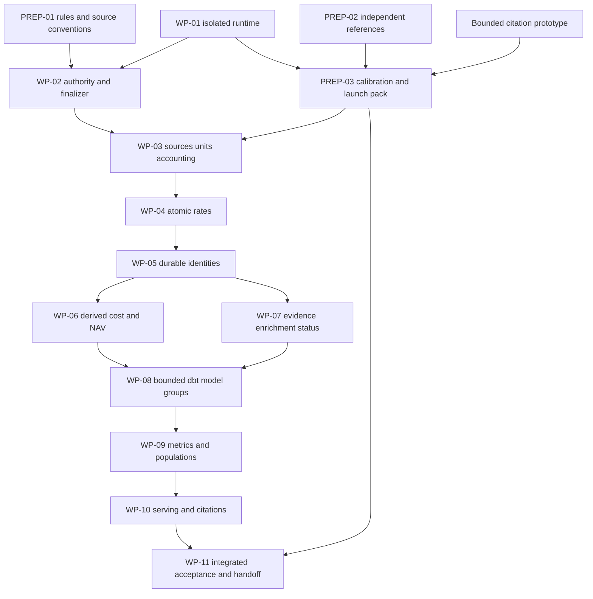

# Programme implementation packages and execution controls

Current specification status, 11 September: the owner accepted measurement-register section 12; sections 13-15 now complete identity/enrichment admission, all-criterion evaluator coverage and worker/interface compatibility for final review. See the [status and handoff](programme_spec_status.md) and [consistency review](programme_spec_consistency_review_2026-09-10.md). D01-D13 remain in force. Implementation must use the scoped observation and CP-01-15 compatibility contracts; a human-labelled benchmark is not required. No new implementation tranche is started by specification completion.

Date: 2026-09-09. Version: 0.3; execution status updated 2026-09-10. The [overnight preparation](programme_spec_closeout_2026-09-09.md) closed at its declared scope. The owner supports amendable numerical working targets and authorized the [bounded first tranche](programme_execution_tranche_2026-09-09.md), then a stronger-preflight retry. Candidate v5 completed holdings, identity and PIK stages but the tranche stopped during full-suite verification after protected test-cache writes. The test-isolation fix has since passed bounded verification; the production regex-validator correction and full-suite verification remain open; financial measurement and recovery verification remain unrun. The [current handoff](programme_tranche_handoff_2026-09-10.md) supersedes earlier task-entry status. Production launch and independent reference approval remain separate; the target programme is not complete.

## 1. End-state and how to use this plan

Deliver a reproducible candidate **ready for owner approval**: position-level holdings and analytics for the 70-BDC cohort, required history Q1-2023 through Q1-2026, persistent borrower/position identities, separately labelled enriched values, and correct HTML/iXBRL evidence navigation. Meet the approved measured contract against the exact data and frontend bundle being presented. PDF highlighting remains deferrable under D10. No public indices or non-BDC expansion.

Use the [target contract](programme_target_contract.md), [data model](programme_data_model.md), [processing design](programme_processing_architecture.md) and [physical design](programme_physical_architecture.md) together. The [measurement register](programme_measurement_register.md) owns acceptance definitions; the [working numerical contract](../../pipeline/programme/contracts/working-v1.json) records the targets endorsed under the [owner amendment process](programme_review_response_2026-09-10.md). The executed pilot owns its dated observations. The live quarter gate remains separate. See [current specification status](programme_spec_status.md) for document authority, automated reference governance and open review findings.

An implementation package can be complete while programme acceptance still fails. For example, a parity-preserving dbt port may preserve a known source-coverage failure. Record both results. Neither a cleaner architecture nor passing internal tests establishes financial correctness.

## 2. Preparation and launch gates

The initial assessment, eligibility inventory, measurement pilot and specification preparation are complete at their stated scope. The table below preserves the original preparation package definitions. Use the closeout and current handoff to identify their remaining implementation obligations; this table is not an instruction to restart preparation.

The preparation table below records the original package definitions. The closeout now supplies SPEC-FX/SPEC-ID conventions, all 61 source dispositions, synchronized legacy candidate results, B2 population impacts, runtime/restore/identity/browser proofs and a numerical/budget proposal. Uncertified rosters, independent sector accuracy, full chains and production runtime enforcement are named implementation obligations. They have not been represented as passing acceptance evidence.

PREP-01 now has a [source-traced authority register and ten runtime replays](programme_rule_authority_assessment_2026-09-09.md): 77 families, 740 assets and 14 control inputs. Ordering, admission, wrapper-resolution, GICS replacement and finalizer behavior are demonstrated at the stated fixture scope. Full rule-instance/selector certification and source-unit/FX requirements remain open; reuse the evidence instead of repeating file discovery.

| Preparation package | Concrete deliverable | Completion and unresolved decisions |
|---|---|---|
| **PREP-01 Active rules and source conventions** | Complete rule-instance records from the saved authority/asset/section inventories: version, loader/writer, admission, field/unit/scope/date predicates, reads/writes, ordering, evidence, consumers and disposition. Trace remaining semantic branches and measure actual selector interactions on an isolated candidate. Complete source-unit/FX needs by field and quarter. | Ten bounded replays are saved; current `.proposed` admission, B2 audit/error and ordering defects are demonstrated, not repaired. After WP-01 isolation, measure full candidate applications and overlaps. Produce the required foreign-currency/date/provider inventory; recommend a pinned FX source/date policy only for genuine conversion needs. Escalate material policy gaps with source examples. No downloads or purchases implied. |
| **PREP-02 Independent reference and evaluators** | Finish or explicitly disposition the remaining 59 source packets from the pilot; primary accounting bases, six Lord Abbett FV dashes, missing/empty statuses, field cases, sector truth, entity nonmatches/continuations and complete chains. Prepare Aurelia/Sentinel label corrections and the remaining classification/join adjudications. | Preserve existing gold; record reviewer, evidence, field currency, instrument/scope, exposure status, sampling probabilities and adjudication. Development examples and previously exposed mg3/mg4/mg5 remain regression assets. Independent acceptance references have separate governance/access. Implement missing measurement adapters against source counterexamples. |
| **PREP-03 Calibration and owner decision pack** | Score a synchronized isolated assessment candidate, report each required numerator/denominator and uncertainty/assessability, and compare against the numerical proposal. Inventory displays and benchmark a narrow citation prototype to propose latency limits. Measure representative run costs. | Present the final gate recommendation, remaining measured limitations, FX recommendation where needed, and a priced/bounded execution tranche. Missing evidence remains unavailable. No live threshold edit until the numerical decision is recorded. |

There are two different launch conditions:

- **Bounded preparation/infrastructure work:** may be scoped and authorized independently using existing contracts and source counterexamples. Candidate isolation, evaluator adapters and a citation prototype need not wait for final population accuracy. Their outputs remain diagnostic and cannot be adopted as accepted data. This document prepares those packages; it does not start them.
- **Open-ended programme remediation:** requires a restorable starting snapshot, tested isolation, active-rule authority map, independently governed evaluation inputs, approved measured gate, sufficient source/FX coverage, explicit execution limits and a packet dependency graph. If a target cannot yet be assessed, the approved tranche must be reference work rather than a promise to remediate until it passes.

This avoids a circular requirement to have a completed viewer before doing any viewer work. The prototype establishes the workload and feasible budget; final WP-10 implements and tests the complete delivery against the approved requirement.

## 3. Dependency order and workstreams

Edges show the conservative integration order. WP-08 is a repeated migration envelope: an individual model group may move earlier once its upstream semantic package and reference checks are fixed. PREP-02 can proceed alongside engineering work under independent review governance. WP-06 and WP-07 can be developed separately after identity contracts stabilize, but shared files and final integration have one owner.

The graph permits independent work; it is not authorization to spawn agents or dispatch fleets. Begin with one lead agent. If later authorized, assign bounded workers only disjoint packages and respect the existing fleet maximum of two, operator skill and ADMIN dispatch requirements. Agent A, B1 and B2 retain their existing grammar, adjudication and correction-proposal roles; they are not the names of the engineering workstreams.

## 4. Package contract

Before execution, instantiate each package with the common record below. Definitions in section 5 are sufficient to scope that record, but fixture IDs/hashes and runtime budgets must be filled before dispatch. A heading or broad goal is not an executable worker packet.

| Field | Required content |
|---|---|
| Identity and objective | Package/attempt ID, one bounded mechanism or model group, success behavior, contract/decision versions. |
| Inputs | Accepted parent and candidate input manifests; exact code snapshot; CIKs/quarters/scopes; admitted decisions; reference/fixture hashes. |
| Dependency and ownership | Required completed packages, integration owner, allowed code/config paths and candidate output directory; incompatible concurrent work. |
| Authority changes | Existing writer/rule to retain, adapt, supersede or retire; intended semantic deltas and affected consumers. |
| Verification | Source examples and counterexamples, targeted test nodes, required suite/build, isolated rebuild, semantic diff, historical re-attestation and performance checks as applicable. |
| Resource envelope | Active-agent and subprocess time limits, attempts, observed/available usage cap, concurrency, external-call permissions and disk/memory limits. Null means unresolved, never unlimited. |
| Stop/recovery | Failure/escalation criteria, last valid checkpoint, rollback, next safe action. |
| Completion bundle | Patch/commit identity without overwriting user work, artifacts/manifests, expected versus observed deltas, tests run/not run, residual risks, immutable handoff record. |

All packages inherit: no SEC calls; no trial writes to production outputs/frontend/baseline; no benchmark or threshold changes by candidate correction workers; preserve non-BDC shared contracts; no overlapping full rebuilds/full suites; no unsupported financial-value completion. A package requiring an exception must make its concrete necessity explicit before dependent execution.

## 5. Engineering packages

### WP-01: Isolated execution, strict artifacts and recovery

- **Delivers:** explicit candidate context and read/write roots; frozen code/input/environment manifest; checkpoint protocol and task ownership from the physical design. Adapt the rebuild and quarter-pass entry points while preserving supported CLI behavior. Pin evaluator paths too.
- **Scope:** `pipeline/config.py` path interfaces, `pipeline/utils.py`, `scripts/rebuild_outputs.py`, `scripts/run_quarter_pass.py`, path-consuming adapters and new narrowly scoped coordinator helpers. Existing dirty changes must be isolated/preserved, not overwritten. Add ignore rules for durable local candidate storage.
- **References/checks:** existing runner, companion-schema and output-protection tests; temporary candidate with bad column order/cast, empty input, missing companion, stale input, partial write, completed FAIL result, process still running and crash after commit. PREP-01 reproduced the missing empty-input companion and relaxed candidate-path default. Request strict companion writing outside `data/output/` explicitly; distinguish preserved failed diagnostics from a complete sealed stage.
- **Done:** a cached diagnostic reconstruction and valid resume use only declared roots; an intentionally stale checkpoint is rejected; protected outputs remain unchanged. No financial values are intentionally changed. Full shared-contract suite and semantic backstop before handoff.
- **Stop/recovery:** any hidden global writer blocks that adapter; keep it out of the candidate until redirected. Reuse the last verified bundle; never patch production JSON to achieve parity.

### WP-02: One rule plan, field contract and final writer

- **Depends:** WP-01 and PREP-01 runtime-authority inventory.
- **Delivers:** one compiled admitted rule plan used by verifier and production; explicit structural/field order and conflict errors; typed stage contracts; finalizer ownership after every field/ID mutation. Audit B2-only application and exclude unadmitted/proposed payloads. An admitted rule execution error prevents successful stage completion/sealing and retains its diagnostics. One pinned wrapper resolver supplies dispatch and staging consumers.
- **Scope:** `pipeline/agent_promoted.py`, correction loader/verifier adapters, `pipeline/unified_holdings.py`, `pipeline/output_schemas.py`, `pipeline/column_validation.py`, relevant producers and tests. Change rule mechanism/schema, not legitimate per-CIK source exceptions indiscriminately.
- **References/checks:** `tests/test_agent_promoted.py`, column/unified tests and source-backed overlapping-rule fixtures. Reuse PREP-01's observed order, proposed admission, B2-only/error and wrapper-resolver cases, preserving its other-CIK/source/quarter counterexamples. Add unresolved same-field conflict, no-op/empty-store audit and stale-source bridge cases. Replay identical inputs through verifier and production and compare values plus application audit. GICS cache match and miss both need an explicit final-authority/evidence result.
- **Done:** every active scoped rule has one authority/disposition and observed application path; no post-finalization writer changes canonical holdings. Record intentional authority fixes separately from parity results. Required shared-contract tests, isolated rebuild and affected historical re-attestation pass.
- **Stop/recovery:** unknown precedence remains an explicit conflict. Do not sort arbitrarily, broaden matching or suppress the failing rule to create a pass.

### WP-03: Source roster, selection, currency and accounting bases

- **Depends:** WP-01/02, source fixtures from PREP-02 and the necessary PREP-01 FX convention/input decision. Full programme remediation starts only after PREP-03's launch decision; an earlier source prototype needs its own bounded preparation packet.
- **Delivers:** document-scoped units/contexts, visible row roster, comparative/amendment selection, observation/source keys, accounting scopes, independent fund-quarter NAV/primary anchors and per-field currency states. Retain USD-default versus reported USD and genuine FX conversion separately.
- **Scope:** `pipeline/bdc_filings.py`, BDC staging, XBRL/HTML wrapper/extraction adapters, source-selection/scope helpers, `pipeline/fund_financials.py` where applicable, FX normalization and associated reference loaders. Use PREP-01's source register and pin both dispatch and staging wrapper consumers in trials. Arelle is a bounded offline comparison subpacket; adopting it requires demonstrated source/locator benefit, including its gaps for untagged rows.
- **References/checks:** Bain's two distinct equity positions, Lord Abbett's 33 rows/six unresolved dashes, Esdec's printed-EUR principal/inline-USD conflict, Aurelia currency and Sentinel parent/JV distinctions; partial amendment, missing file, comparative period, reported USD, genuinely foreign, absent evidence and unresolvable unit counterexamples.
- **Done:** source selection is independent of extraction success; all reviewed occurrences have dispositions; actual units and independent accounting denominators are carried into an isolated boundary bundle. Correct source cases and shared non-BDC compatibility pass. Missing FX/source truth remains measured missingness, not a forced USD value.
- **Stop/recovery:** absent source currency/rate or incomparable accounting basis blocks that value/metric and its dependent acceptance. No new historical HTML campaign or download is inferred from the gap.

### WP-04: Atomic all-in interest-rate migration

- **Depends:** WP-02/03 and frozen rate-specific source fixtures.
- **Delivers:** all-in `interest_rate`, separate PIK rate and explicit cash interpretation, with all affected income formulas and Agent A/B2 conventions migrated together. Remove unsupported rate imputation under the target contract.
- **Scope:** rate parsing/normalization, promoted correction adapters, `pipeline/unified_holdings.py`, `pipeline/index_returns.py` and other consumers identified in the crosswalk; affected schemas/tests as one packet. Legacy backend returns remain compatible without adding a public index surface.
- **References/checks:** Paragon's visible/inline rate disagreement; cash-only, mixed cash/PIK, PIK-only, fixed/floating, zero, missing and basis-point cases. Verify storage, provenance, validation and downstream cash+PIK income together. Include an unsupported benchmark/median fallback case that must remain unknown.
- **Done:** source-supported cases and consumer formula checks pass; an isolated full dependency rebuild has explained rate/income deltas with no double-counted PIK. Relevant signed-quarter re-attestations remain explicit. A storage-only or formula-only patch cannot complete this packet.
- **Stop/recovery:** conflicting cash/all-in meaning blocks the entire atomic migration. Roll back the packet as a unit; do not ship half of it.

### WP-05: Durable entity and position identity

- **Depends:** WP-02/03/04; normalized matching inputs expose reported cost, source-derived classifications, maturity precision and supported rates before analytical cost/sector enrichment.
- **Delivers:** registry snapshots and migration map; stable source-anchored row IDs; borrower assignments within/across filers; within-fund/scope position/lot assignments, links and revision records. Entity merges/splits invalidate dependent sector assignments.
- **Scope:** `pipeline/position_matching.py`, `pipeline/position_id_registry.py`, actual entity-resolver/lookup writers identified in PREP-01, maturity normalization and assignment consumers. Preserve contested assignment and maturity veto where consistent with the contract. Do not infer cross-filer instrument identity.
- **References/checks:** existing position matching/registry tests and exposed gold as regression; independently reviewed entity nonmatches, continuations and chains for acceptance. Include same borrower/different facilities, simultaneous lots, parent/JV, renamed borrower, month-end/exact maturity, prior-period amendment, earlier-quarter addition, merge/split, reordered input and interruption after allocation.
- **Done:** IDs survive replay/unrelated additions and accepted-history extension; ambiguous mappings remain explicit; semantic twin builds include stable IDs. Rejoin final match financial columns later without recalculating accepted links. Report separate entity/position precision, recall and chain completeness with assessability.
- **Stop/recovery:** a collision is a reviewable identity defect, not permission for an amount-based row suffix. No donor cost or inferred sector may circularly justify an identity. Trials never update the accepted registry.

### WP-06: Analytical cost and NAV derivations

- **Depends:** WP-05 and independent P02 financial/FX inputs; this package implements P06 after identity.
- **Delivers:** preserve reported cost; select first observed same-position FV only for truly absent cost, with donor lineage; retain reported NAV percentage and separately calculate aligned FV/NAV. Public portfolio weights remain a separate definition.
- **Scope:** cost/percentage helpers in unified holdings, typed derivation adapters or model group, match financial projections and affected analytic consumers. Keep framework-port changes in WP-08 unless the reviewed packet explicitly establishes this model's initial implementation.
- **References/checks:** missing cost, reported zero, zero FV donor, negative FV, invalid/unconverted disclosed cost, uncertain position, auxiliary earlier history, later first available donor, revised earlier quarter, absent/zero NAV and legitimate reported/calculated disagreement. Existing percentage-overwrite tests must be revised to the accepted meaning, with source-backed expectations.
- **Done:** every proxy names its same-release position/donor and absent-source input; source zero wins; NAV inputs match date/scope/currency. Tests and isolated before/after field, income and public-analytic deltas pass their defined checks.
- **Stop/recovery:** do not use another borrower facility's FV or a stale previous-run NAV. Rebuild affected full chains and dependent history when earlier evidence changes.

### WP-07: Field evidence, enrichment and PIK status

- **Depends:** stable WP-03/05 interfaces; integrate any derived field links with WP-06 before P07 sealing.
- **Delivers:** logically complete field states and typed inputs; distinct availability/derivation/correction/verification axes; required sector-level GICS assignments with taxonomy/method/review evidence; strict PIK status separate from terms and terms-started transitions. Model inference is a separately admitted decision, not part of deterministic rebuilds.
- **Scope:** provenance/correction audit adapters, GICS mapping/classification caches and assignment projection, `pipeline/bdc_position_pik.py`, `pipeline/pik_status.py`, field evidence/status sidecars. Preserve legacy missing provenance as unavailable.
- **References/checks:** sector-only decision, conflicting cache/abstention, changed entity identity, inferred-versus-reported value, missing locator, cyclic/invalid field input, cost/FX/NAV links, terms with no current PIK proof and current PIK with source evidence. PREP-01's cache-match overwrite and cache-miss clearing cases require explicit final authority and preserved decision history. Use independent sector references, not cache fill, to score accuracy.
- **Done:** expanded field-state coverage is exact; typed FKs and dependency graph validate; inferred values remain labelled inferred even after review. Report accuracy/coverage by decisions, rows and absolute FV separately. No terms-started transition is labelled confirmed distressed PIK.
- **Stop/recovery:** missing prompt/model history cannot be fabricated. A failed enrichment investigation records abstention and impact; it does not relabel an unsupported value as reported.

### WP-08: dbt migration by established model group

- **Depends:** WP-01 and the semantic package controlling the selected model group. Repeat this package for P02 selections, P03 relational normalization, P06 derivations and P08 metrics as their contracts become ready.
- **Delivers:** bounded dbt/DuckDB model group with explicit typed inputs, dependencies, outputs and checks; retire that group's prior SQL/Python transformation authority. Python remains the specialized extraction/correction/identity boundary.
- **Scope:** production dbt project and environment lock, stage adapters and the specific old transformation being replaced. Reuse `spikes/dbt_roundtrip` and the spike findings as evidence, not a completed migration. Do not migrate every JSON correction payload into independently editable seeds.
- **References/checks:** pinned candidate and counterexamples of the selected group; typed/schema/FK tests and full failing-population counts. Archive complete evaluation results beyond dbt's limited/replaced stored-failure relation. Include source path, schema/column-order, null/zero and deterministic replay cases.
- **Done:** measured semantic parity to the post-correction baseline, equal IDs/evidence and bounded memory/runtime; necessary suite and semantic backstop pass. Record old reader/writer retirement and remaining compatibility adapters. No unexplained financial delta is accepted as framework behavior.
- **Stop/recovery:** an unexpected semantic difference returns to its owning package. Keep old and new paths available for comparison within the trial; only one becomes production authority after the governed transition.

### WP-09: Exact public populations and metric contracts

- **Depends:** finalized WP-03 through WP-08 data contracts and field/identity evidence.
- **Delivers:** population membership, metric definitions/results/inputs, display bindings and exact common decimal aggregation. Primary reconciliation populations remain independent of public holdings populations. Full history is queryable through explicit manifests.
- **Scope:** fund/cohort analytics and export-input models, `pipeline/export_frontend.py` metric readers and their schemas. Retire filing/reconciled/scaled alternatives for the headline/instrument/industry totals governed by the canonical holdings population.
- **References/checks:** unknown GICS/instrument bucket, subsidiary rows, negative/zero FV, facilities and cash, same borrower/different positions, missing analytic input and all required quarters. Test persisted scientific/sub-cent tokens, exact grouping equality and arithmetic overflow rejection under the physical design.
- **Done:** headline and instrument/industry sums agree exactly to the same current-quarter cohort holdings; every metric declares population, denominator, coverage and evidence path. Missing analytic inputs cannot remove positions from the holdings product. Isolated export-shape and numerical checks pass.
- **Stop/recovery:** no scaling, deduplication, matched-subset denominator or patched frontend JSON may repair disagreement. Trace discrepancies back to the CSV population/metric definition.

### WP-10: Static serving, source highlights and delivery checks

- **Depends:** WP-09 for full integration; a bounded source/citation prototype may run during PREP-03 using fixed development fixtures.
- **Delivers:** explicit release-qualified static JSON/contributor/history shards, evidence resolver and cached HTML/iXBRL viewer assets. A number opens its exact reported source, calculation inputs or inference explanation; missing evidence has an honest unavailable state. Complete contribution lists retain totals/counts across pagination.
- **Scope:** `pipeline/export_frontend.py`, frontend data/types/routes/components, build-time shard/document preparation, browser fixtures and display registry. Preserve the Next.js app and v1 scope; no warehouse query service is required.
- **References/checks:** repeated equal numbers in different rows, comparative date, amended filing, untagged source cell, parent/JV distinction, inferred sector, first-FV donor, unavailable locator and multi-page aggregate. Verify source document hashes and selected highlighted content, not just an HTTP success or a link's presence.
- **Done:** frontend build and actual browser scenarios pass against the sealed candidate. Measure citation accuracy/coverage on independent source/display denominators; run the approved cold/warm/device/network workload and report p50/p95. Old pages use their own complete release; mixed-generation requests fail safely. All required position history is accessible.
- **Stop/recovery:** never highlight the first matching number or substitute a generic fund page as successful evidence. Architecture-diagram browser tests do not count as product citation tests. PDF remains deferred unless its scope is explicitly brought forward.

### WP-11: Integrated acceptance, restore and owner handoff

- **Depends:** PREP-03 launch decisions and all required package proofs, including storage/backup gates applicable to the proposed transition.
- **Delivers:** final frozen candidate, P07/P08/P10 seals, full required-history acceptance, historical regression evidence, semantic twin build, tested interruption/restore, retirement map, operating/recovery instructions and concise owner review pack.
- **Scope:** integrated runner/evaluation/reporting, release descriptors and staged serving bundle. Prepare concrete adoption/rollback steps; do not publish, merge or refresh a baseline as part of being ready for approval.
- **References/checks:** all twelve logical invariants, 28 measurement criteria, current live quarter gates and approved programme gates, affected signed-quarter re-attestations, relevant full test suite, frontend build/browser checks, complete dependency/hash verification and source-to-public trace examples.
- **Done:** every mandatory criterion passes or has an exception expressly permitted by the approved contract; no required metric is silently unassessable. The review pack names the exact candidate, outstanding permitted limitations, migration/semantic deltas, evidence and rollback target. Owner intervention is approval of a concrete release, not unfinished engineering coordination.
- **Stop/recovery:** stop and report signed-quarter regression, missing acceptance truth, unbounded source gaps, unexplained drift or exhausted limits. Preserve the failing candidate and the residual worklist; do not lower a gate or change gold to achieve completion.

## 6. Existing conflicts and architectural increments remain traceable

| Prior packet | Implementation ownership | Processing increment |
|---|---|---|
| CR-01 shared authority, schemas, final writes | WP-01/02; WP-03 source/population boundaries | PA-01/02 |
| CR-02 atomic rates and income | WP-04, with later parity-only model port | PA-02 |
| CR-03 units and FX | PREP-01, WP-03 | PA-02 |
| CR-04 cost and NAV percentages | WP-06 after WP-05 | PA-04 |
| CR-05 identity/maturity/PIK joins | WP-03 maturity inputs, WP-05 identity, WP-07 status joins | PA-03/04 |
| CR-06 provenance, sector and meaning | WP-07 | PA-04 |
| CR-07 public metrics, full history and citations | WP-09/10/11 | PA-06 |
| Framework migration across resolved contracts | Repeated WP-08 | PA-05 |

F01-F12 mechanisms and their source/test references remain in the [conflict resolution](programme_conflict_resolution.md). This table adds execution ownership; it does not retire or renumber those decisions. Dagster remains a later equivalent-stage scheduling migration, outside the initial completion requirement unless added explicitly.

## 7. Run limits, stopping and resumption

Proposed operational defaults for the first authorized tranche:

| Control | Proposed setting / behavior |
|---|---|
| Integration ownership | One lead coordinator; one writer per candidate/database/registry allocation. No agent fleet without separate authorization. |
| Persistence | Save after each completed action/decision and before an external request; no more than five active minutes between durable progress records. Save next action and exact evidence paths. |
| Automatic retry | At most one retry after a diagnosed transient infrastructure failure. Input/code changes create a new attempt/candidate as required; quality failure is not transient. |
| Investigation bound | At most two evidence-backed mechanism proposals for the same unresolved residual before escalation. Do not relaunch the same hypotheses in a fresh conversation. |
| Long jobs | Check existing processes first. Each command has an explicit timeout/resource envelope derived from measured representative runs; record and stop only the owned process. No overlapping full suites/rebuilds. |
| Task selection | Work only the authorized dependency-ready queue. When one packet blocks, continue other authorized independent packets; do not keep retrying the blocker or change programme scope. |
| Protected evaluation | Candidate workers cannot alter acceptance labels, thresholds or approval records. Adjudication and evaluator changes have separate reviewed versions. |
| Usage interruption | Resume from persisted task and manifest state; verify existing process ownership and completed artifacts before rerunning. No assumption that a process survives a usage window. |

Before long-running execution, the owner decision pack must set the **total active-agent time/usage budget**, tranche scope and external-call budget; representative runs must set subprocess, memory and disk limits. Do not present guessed token or wall-clock totals as measured estimates. Record usage only where the execution environment exposes it; otherwise enforce the supported time/attempt caps and label token usage unavailable. A missing limit is not an unlimited allowance.

The first tranche has executed and stopped with incomplete verification. A subsequent package should first close bounded execution readiness, then complete candidate measurement and recovery before broader remediation. Set its limits from observed workload costs. Budget exhaustion means save a resumable handoff and stop further spending; it does not mean the end-state was achieved.

Escalation records contain the question, source evidence, hypotheses/results, affected rows/FV/quarters, attempted mechanism, remaining options, recommendation and next safe independent task. Surface material financial-policy decisions to the owner; handle routine engineering decisions within the agreed package. Previously resolved D01-D13 do not need repeated approval.

## 8. Verification and final completion record

Use proportional verification during implementation. Target the affected tests first; shared contracts/broad refactors require the full suite before handoff, with the repository's duration flags and no competing suite. After pytest run `python scripts/diff_outputs.py --semantic` as the production backstop. That baseline check does not compare candidate contents: also run an explicit candidate-to-pinned-parent semantic comparison and explain intended deltas. Preserve existing unrelated baseline divergence rather than attributing it to a trial.

Cached rebuilds and re-attestation must use explicit candidate paths; unsupported scripts require adapters before use. Frontend changes require the frontend build and applicable browser checks. Do not refresh the official baseline or edit established gold to clear a regression. Internal consistency tests, tag-copy agreement and fill rates stay separate from independently measured accuracy.

The final review pack contains: objective/contract versions; exact code and data/delivery seals; required-history coverage and accuracy; identity/sector/evidence results; public totals; current and historical gate verdicts; uncertainty/assessability; semantic deltas and source examples; tests run/not run; recovery/restore evidence; retired writers/adapters; remaining contract-permitted limitations; resource use; and concrete adoption/rollback steps. Programme state is one of `preparing`, `executing`, `blocked`, or `ready_for_owner_approval`, with evidence for the state.

**Current state: specification preparation closed; implementation stopped with verification incomplete.** The first tranche delivered runner/evaluator code and three completed legacy candidate stages. It did not complete its verification, financial measurement or recovery obligations. The product is not ready for approval. The owner requires automated source verification without a mandatory human-labelled gold set. PREP-02/PREP-03 and the WP-11 evaluator contribution must implement the [automated reference-admission protocol](programme_spec_status.md#automated-reference-verification-no-human-label-prerequisite); no human reviewer appointment is required. The [handoff](programme_tranche_handoff_2026-09-10.md) records the executed candidate. Historical `preparing` records retain their original dates.
