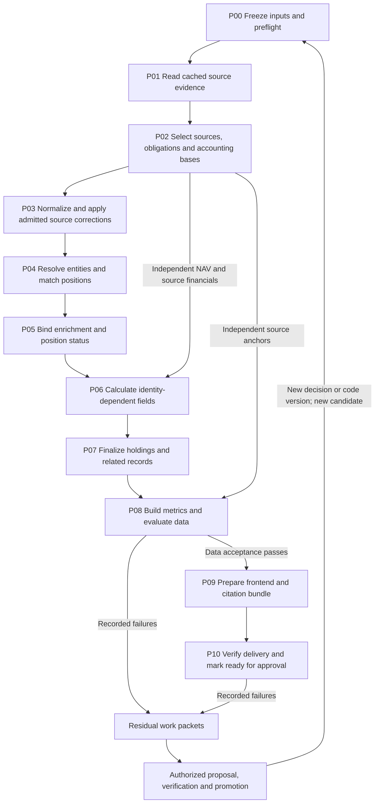

# Programme processing architecture

Date: 2026-09-09. Version: 0.3; verification interfaces completed 2026-09-11. The target processing design remains unimplemented. Measurement-register sections 12-15 now define source/identity/enrichment admission, scoped acceptance and coupled worker interfaces for final review; section 12 is owner-accepted. A first programme tranche executed legacy holdings, identity and PIK builders through an isolated runner; its verification and measurement are incomplete. See [specification status](programme_spec_status.md) and the current handoff for the distinction.

[Open the standalone data-flow diagram](programme_data_flow.html): bronze/silver/gold, source-total and citation paths, frozen rule inputs and the agent remediation loop. Select a stage to inspect its inputs, outputs and owner. The HTML works offline.

## 1. Recommended architecture

Use a deterministic, checkpointed batch pipeline, coordinated by Python, with dbt/DuckDB owning the large relational transformations. Keep specialist Python extraction, matching, source validation and reviewed correction mechanisms behind explicit input/output boundaries. Agents propose improvements through the existing verification/promotion route. A candidate is assembled and evaluated from frozen inputs; it does not call a model to invent a missing decision during a rebuild.

The end product is a complete data and frontend candidate **ready for owner approval**. Data acceptance precedes release-candidate export, and delivery acceptance follows export so that the actual JSON, navigation and citations are tested. Publication is a subsequent owner-controlled action.

This implements the [data model](programme_data_model.md), [target contract](programme_target_contract.md) and [F01-F12 resolutions](programme_conflict_resolution.md). The [measurement register](programme_measurement_register.md) controls evaluation definitions. D01-D13 remain resolved; numerical approval under D12 remains outstanding.

The design makes four changes to the older [stack diagram](production_data_stack_plan.md):

1. Entity and position assignment occur before final holdings and identity-dependent cost. They no longer rewrite an already exported CSV.
2. Complex corrections remain typed, reviewed Python operations where appropriate. Moving configuration to dbt does not require translating every rule into SQL or making all JSON stores seeds.
3. Validation findings cannot silently become build inputs. Promoted decisions enter a new frozen candidate.
4. A complete release includes evidence, identities, metrics and frontend artifacts. A successful SQL run alone is insufficient.

The accepted programme chooses dbt migration. The earlier dbt-versus-SQLMesh exploration is historical context, not a requirement to reopen the framework decision. Dagster remains the planned later scheduling layer; the initial implementation extends the existing checkpointed Python runner and preserves its operator entry points. Scheduling migration must call the same stage interfaces and prove equivalent results.

## 2. Processing graph



The arrows describe dependencies, not a requirement to serialize every fund. Source documents can be read independently; independent fund facts can be prepared alongside holdings normalization. Entity resolution spans filers, and position matching spans history, so those stages require wider dependency accounting than a quarter-only partition.

Previously admitted rules, classifications and registries are P00 inputs to every applicable stage. The graph shows the remediation route once, rather than drawing those inputs repeatedly. A proposed decision discovered during a run never modifies that run's frozen inputs.

## 3. Stage contracts

Every stage receives an explicit run context and input manifest. It returns typed artifacts, their hashes/schemas/counts, quality findings, application audit and execution outcome. A stage has one owner for each output. Downstream stages read completed artifacts, not live mutable tables or a directory glob that can gain new files during execution.

`R` below is the candidate's `release_id`. Relation names refer to the data model; names prefixed `stg_`, `int_` and `mart_` are proposed dbt model families, not existing production models.

| Stage | Inputs and work | Outputs and sole owner | Completion boundary |
|---|---|---|---|
| **P00 Freeze and preflight** | Pin code plus dirty patch, environment, cohort/history, source inventory, wrappers/grammars, source-selection policy, corrections/reviews, taxonomy/FX, registries, schema, metric definitions, display bindings and evaluation references. Check paths, resources and competing work. | Python coordinator: release input manifest, expected fund-quarter frame, execution plan, isolated working paths and accepted registry copies. | No implicit source downloads/model calls; missing required execution dependencies or conflicting writers are explicit failures. Missing source coverage is recorded against the expected frame. Every intended input has an identity. |
| **P01 Read cached evidence** | Process relevant cached document versions through existing XBRL/HTML readers and wrappers. Retain facts, contexts, units, visible row/cell locators, nils, dashes, comparative dates and extraction diagnostics. Collect source PIK/non-accrual facts and source fund financials here. | Python source adapters: document/context/unit/evidence/occurrence records and extraction issues. Optional evaluated Arelle adapter supplies separate standards findings. | Account for attempted documents, including failed reads. No FV-tag-only roster; no economic deduplication of the immutable evidence store. |
| **P02 Select sources and bases** | Choose authoritative schedules by documented latest-best precedence, including partial amendments. Establish fund-quarter obligations, lifecycle status, source scope, and independent NAV/investment totals. Normalize independent fund facts using the shared unit/date functions. | Python interpretation plus dbt selection models: `source_selection`, `fund_quarter`, scope mappings, typed source fund metrics and provisional anchor definitions. | Selection cannot depend on how many holdings survived extraction. Missing/incomparable totals and eligible output gaps remain visible. Source selection, dates and scope must be reproducible. |
| **P03 Normalize and correct** | Convert source representations to typed values; interpret units, rate kind, maturity precision and source classifications. Apply the compiled rule plan at its declared pre-normalization, structural and field boundaries. Retain presentation dispositions and admitted recovery evidence. | dbt `stg_*`/`int_normalized_*`, with typed Python correction adapters: corrected observation candidates, stable source-row identities, field states, rule application events and a matching feature projection. | No duplicate rule implementation or unreviewed fallback. Preserve zero/negative values, distinct lots, source/raw values and unknowns. Join multiplicity and final field units at this boundary are checked. |
| **P04 Resolve identity** | Resolve borrower entities across names/filers using P03 source-backed features and pinned decisions; then match positions within filer/accounting scope over the admitted history. Allocate IDs in candidate-local registries. | Existing Python resolver/matcher/registry adapters: entity and position assignments, candidate/accepted/rejected links, revisions and registry outputs. | Assignments are unique, registries stable, uncertainty explicit. Distinct lots remain distinct. Matching uses reported cost, not the proxy it would later justify. |
| **P05 Bind enrichment and status** | Select source-reported or admitted inferred borrower-sector decisions against the new entity assignment and effective dates. Bind current PIK/non-accrual evidence to observations; calculate terms-transition relationships using accepted position links. | Classification/status Python adapters and dbt joins: selected GICS assignments, typed status and transition records, related field states and evidence edges. | No live model call. Stale entity-bound classifications are rejected or unresolved. Terms/current/stress claims remain distinct; unknown does not become false. |
| **P06 Calculate dependent fields** | Choose same-position first-observed-FV donors; calculate analytical cost, NAV percentages using independent fund NAV, and other approved observation-level arithmetic. Use P02 fund financials and pinned FX. | dbt `int_cost_donors`, `int_holding_derivations`: completed typed observation fields plus donor/denominator/FX lineage. | Reported zero wins; absent reported cost differs from invalid/unconverted cost. No unresolved cross-position donor or hidden old-run input. Calculation graph must be acyclic. |
| **P07 Finalize holdings** | Assemble P03-P06 fields, IDs, status/evidence and applicable shared non-BDC compatibility data into one complete candidate data snapshot. Validate final physical schema and logical constraints after every value-changing step. | `pipeline.unified_holdings` as finalization coordinator: canonical candidate CSV, corresponding typed companion, observation metadata, assignment/link/status/evidence companions and a frozen data manifest. | One writer; row/field projections and release IDs agree. Re-join match begin/end financial values to finalized holdings without recomputing identity. No later enrichment or ID writer can modify this snapshot. |
| **P08 Metrics and data evaluation** | Build exact public and analytic populations, metrics, anchor memberships and reconciliation. Evaluate source rosters/fields, identity/chain and enrichment references, provenance, rule drift, quarter gates and signed-quarter regressions. | dbt `mart_*` owns calculated metrics/populations; independent Python evaluators own reference comparisons, verdicts and residuals. Add an evaluation manifest bound to P07 hashes. | Produce PASS/FAIL/NOT_ASSESSABLE for every required check. Structural pass and calibrated data acceptance are both required to advance the release candidate. Unapproved numerical gates cannot yield final acceptance. |
| **P09 Prepare serving** | Serialize accepted data/metrics into complete holdings/history access, public JSON, evidence indexes, contributor pages and document-viewer assets. Build the frontend from pinned source and bindings. | Python exporter, citation adapter and existing frontend build: staged public bundle, document/rendition mapping, display bindings and artifact manifest. | Read P07/P08 and their admitted document/viewer dependencies. No private financial formulas, source discovery, identity assignment or corrections in export. Full public population preserved across pagination. |
| **P10 Verify delivery and readiness** | Exercise the staged frontend and resolver; test exact totals, completeness, meaningful missingness, repeated-number highlights, inference/calculation paths and prescribed performance workloads. Verify complete manifest and runtime/regression evidence. | Independent delivery evaluator and coordinator: final acceptance pack and append-only `ready_for_review` or `not_ready` event bound to the sealed bundle. | The actual tested artifacts are the candidate for approval. No automatic publish. Any data/code/viewer change invalidates dependent results and requires a new sealed candidate. |

There are two seals: the P07 data snapshot and the P10 complete delivery bundle. Later stages may add their declared outputs to an unsealed candidate, but cannot mutate a sealed stage's files. This lets export and browser checks run against fixed data before the complete release is sealed.

Programme identity and historical-coverage requirements apply to the governed BDC subset. Shared N-PORT and other backend products retain their source-specific contracts; they are not forced into BDC fund-quarter or accounting keys. Their compatible inputs/outputs must still be pinned when the shared canonical artifact is assembled. Changes to shared rate or schema semantics require the affected non-BDC consumer checks as well.

P08 contains metric construction followed by independent evaluation; these are separately checkpointed tasks with separate write paths. Evaluators have read-only access to candidate data and write results elsewhere. A failing candidate may produce an explicitly diagnostic local preview when useful for remediation, but it is not an accepted P09 release export and cannot acquire `ready_for_review` status.

## 4. Tool and module boundaries

| Component | Responsibility in this design | Boundary |
|---|---|---|
| **Python coordinator** | Run planning, artifact/version checks, stage invocation, checkpoints, process/resource ownership and final release assembly | Extend the existing runner; do not implement financial meanings in orchestration branches. |
| **Python extraction and interpretation** | Cached document reading, wrapper/grammar application, HTML row/cell mapping and complex source parsing | Preserve original evidence. Remove or expose any current pre-roster filtering so it cannot erase the independent raw record. |
| **dbt + DuckDB** | Large joins, selected-source models, typed normalization projections, relational rule applications, donor windows, populations, metrics and boundary tests | Several named dbt segments surround specialist Python stages. dbt dependencies must refer to explicit Python-produced artifact sources. |
| **Python correction executor** | Existing complex promoted-rule mechanisms, scope matching and application audit using one compiled precedence plan | Returns typed candidates and audit. It does not overwrite canonical CSV or create its own competing SQL implementation. |
| **Python identity and enrichment adapters** | Existing entity resolver, contested matcher, registry allocation and classification/status decision binding | Read typed stage inputs and return assignments. Separate proposal generation from deterministic decision consumption. |
| **Arelle adapter, subject to evaluation** | Standards-aware XBRL fact/context/unit interpretation and validation; possible preparation of iXBRL viewer assets | Initially a bounded comparison/diagnostic adapter. It does not replace filer-specific schedule semantics or decide entity identity. |
| **Existing independent validation stack** | Source reconciliation, source-labelled checks, gold matching, rule verification, quarter acceptance and re-attestation | Candidate population and reference population are distinct. Preserve failure artifacts and governance of reference labels. |
| **Python export + Next.js** | Presentation serialization, static holding/contributor shards, navigation and rendering | Consume declared metric values and lineage. Formatting may change presentation, not financial meaning or membership. |
| **Dagster later** | Scheduling/visibility around the same stage contracts | Preserve the stack plan's equivalent-quarter-pass migration gate. No scheduler migration is necessary to write or review this specification. |

DuckDB execution uses one owning writer process per writable database file; separate processes exchange completed typed artifacts or use separate databases. This is a deliberate fit for the embedded deployment, consistent with [DuckDB's documented embedded concurrency model](https://duckdb.org/docs/lts/connect/concurrency). The design does not require a database server.

### dbt project shape

```text
sources:   frozen extracted evidence, source financials, admitted rule inputs
segment A: stg_bdc_* / stg_nport_* -> selected and typed observation candidates
Python:    complex correction executor at declared segment boundary
segment B: corrected matching features and source/field consistency checks
Python:    entity resolution -> position matching -> registry assignments
Python:    bind approved entity enrichment and status evidence
segment C: identity joins -> cost donors -> calculated fields -> final projection
finalizer: canonical CSV + Parquet and related manifests
segment D: populations -> metrics -> reconciliation and boundary tests
Python:    independent data evaluation -> export -> delivery evaluation
```

This is one dependency graph executed through several tool invocations. Python stages are declared artifact producers; they are not hidden side effects inside a dbt model. No dbt model calls an LLM, allocates persistent IDs or edits an override store. Shared deterministic conversions have one implementation, either a dbt macro or a typed upstream function; do not maintain two subtly different currency/rate implementations.

Use dbt seeds for small, static, tabular references where appropriate. Validate and flatten hierarchical correction JSON into typed candidate inputs while preserving its original hash, decision ID and approval status. Keep executable correction mechanisms in their existing Python module until deliberately ported and retired there. Compiled SQL and dbt manifests are run evidence; they do not replace field-level source lineage.

The [local spike](dbt_spike_report.md) proves one boundary-failure round trip on three CIKs, not full-pipeline readiness. Preserve its successful pattern and address its recorded production gaps: isolated locked environment, explicit materialization, absolute resolved artifact paths, scoped dbt test profile and native-write protection. Existing contract enforcement and protected-output manifests must ship with the first materialized model. No dependency installation or production dbt project is claimed by this design.

### Arelle adoption boundary

The official CLI supports local input, explicit offline connectivity, taxonomy packages and validation. The adapter must pin its version/plugins, document set and taxonomy resources, use offline mode and record missing dependencies instead of fetching them. A standards validation issue is source evidence to interpret, not automatic proof that every position in a filing is unusable. [Arelle CLI documentation](https://arelle.readthedocs.io/en/latest/command_line.html).

Evaluate it on the existing source cases: opaque unit IDs, conflicting printed/tagged currency, rate scaling, repeated facts, comparative contexts and untagged schedule rows. Compare emitted identities/values/diagnostics with cached sources; preserve source errors such as Paragon's display/tag conflict. An Arelle parse or validation pass is not an independent financial-accuracy benchmark. If dependencies are absent, report the adapter as unassessable; do not claim a standards check passed.

For navigation, evaluate [Arelle's iXBRL Viewer](https://github.com/Arelle/ixbrl-viewer), which exposes tagged data interactively in a browser. The programme still owns the release/field-to-fact mapping, untagged HTML cell locators, contributor lists and inference explanations. Viewer preparation produces a rendition linked to the immutable original document hash; IDs introduced in a rendition must have an explicit mapping back to the source. Initial viewer adoption is contingent on the source-navigation tests, not a wholesale extractor replacement.

## 5. Financial field ownership and rule order

| Field or decision family | Authoritative processing point | Downstream use |
|---|---|---|
| Filing selection, report dates, lifecycle and accounting scope | P02, from source evidence and admitted scoped decisions | P03 cannot replace a chosen source because a different filing extracts more easily. |
| Source FV/cost/principal units; reported rates, cash/all-in/PIK interpretation; maturity precision | P03 after applicable source corrections | P04 consumes typed reported features. P06 uses them without reinterpreting source units. |
| Source-row inclusion, duplicate presentation and explicit lot decomposition | P03 structural boundary, with retained occurrence dispositions | Identity and totals operate on the resulting retained roster. No late global subsidiary drop. |
| Instrument/lien classifications used by matching | P03 from source rules and eligible pinned decisions | P04 receives this specific feature snapshot, not a future enrichment output. |
| Borrower and position IDs | P04 | P05/P06 attach decisions and donors; P07 projects IDs once. |
| Selected borrower GICS sector and optional sub-industry | P05, using source candidates and admitted entity/observation assignments | Entity changes invalidate dependent assignments. Fund strategy remains a separate subject. |
| Strict current PIK, evidence-aware non-accrual, terms transitions | Raw evidence P01; source normalization P03; final identity binding P05 | Status/transition metrics have separate definitions and source coverage. |
| Analytical cost, calculated NAV percentage | P06 | Reported cost/percentage remains separate. Record donor and denominator references. |
| Public/analytic metrics and accounting membership | P08 | P09 reads the values/populations; no dashboard-specific deduplication or denominator replacement. |
| Final physical rows, column order and companion consistency | P07 | Every consumer reads this immutable data snapshot or an exact projection. |

### One compiled correction plan

Compile the admitted stores into a versioned execution plan containing: rule/decision ID, source-store hash, stage, selector scope, read/write fields, expected units, dependencies, applicability, supersession and evidence. The verifier and production executor consume the same plan and the same rule implementation.

Ordering follows semantics:

1. Source-specific interpretation/exclusions at their declared raw boundary. Keep the original occurrence and disposition even when excluded from normalized candidates.
2. Structural roster operations and source recovery: duplicate presentation, supported lot splits and accounting mappings.
3. Typed field corrections, followed by revalidation of affected units/types.
4. Source-dependent classification/feature selection before matching.
5. Identity, then identity-bound enrichment and derived values.

A rule that changes inputs used by an earlier step belongs at that earlier boundary; it cannot be added as a convenient final overlay. Two overlapping writers require explicit dependency or supersession. Alphabetical filenames and `fix_class` sorting are not sufficient semantic precedence. If the plan cannot establish a unique valid order, emit a conflict and stop affected construction rather than silently choosing one.

Record applied/no-op/rejected/failed outcomes for every admitted rule store, including B2-only, zero-row and disjoint-quarter cases. Audits include selected row IDs, before/after values, input units and actual output impact. Idempotence is tested: retry starts from the pinned pre-rule snapshot, not from a possibly already corrected output. Independent source evaluation remains separate from the shared execution mechanism.

### Matching without circular cost or classification

The existing [matcher](../../pipeline/position_matching.py) reads `cost`, maturity, principal, rates and classification features, and uses cost proximity in assignment. Consequently, moving cost derivation later requires an explicit **matching-input contract**, not just moving a function call.

P03 supplies reported/usable cost as `cost_reported` and exposes it through the matcher's input adapter; absent reported cost remains absent in matching. Source-independent normalizations and admitted evidence-backed corrections are allowed. P06 FV proxies are unavailable to the matcher. Public analytical cost can later use the resulting position ID, with its donor recorded.

P04 first resolves entities, then uses those assignments in position matching. Any matching classification comes from the frozen P03 feature snapshot. Borrower-sector outputs selected in P05 cannot feed back into the same identity decision. If a current feature depends on such an output, migrate or remove that dependency with focused matching validation; do not run enrichment/matching repeatedly until the score looks satisfactory.

Final match companions may carry beginning/ending financial columns for existing consumers. P07 derives those columns by joining accepted links to finalized observations. This updates the financial projection without changing the already-decided edges or assigning IDs again.

## 6. Agent and enrichment work

The owner's 10 September direction requires [automated source verification](programme_spec_status.md#automated-reference-verification-no-human-label-prerequisite), without a mandatory human-labelled benchmark or reviewer appointment. Reuse B1/B2/B3 responsibilities and extend their evidence, coverage and admission checks within D13. Source-selected reference audits must also cover apparently passing and missing-output cases; the residual queue alone cannot establish population accuracy. These are required integration changes, not authorization to replace the agent workflow or launch workers. Older worker instructions requiring human disposition of routine ambiguity need an explicit compatibility update before programme execution uses the new route.

The [complete compatibility map](programme_measurement_register.md#15-worker-rule-and-interface-compatibility) supplies that target update for all declared route families. Apply CP-01-15 to actual runtime instances with source/rule hashes and shared producer/consumer versions. The [observation/admission contract](programme_measurement_register.md#14-complete-requirement-to-check-contract) controls source references and scoped acceptance; legacy schema/attestation success alone does not grant the new claims.

There are two execution modes sharing the same deterministic evaluator:

- **Candidate build:** consumes previously admitted, versioned inputs. It is repeatable and contains no live LLM inference or implicit model spending.
- **Authorized investigation/enrichment task:** consumes a bounded residual or classification packet, can produce a proposal, and must pass the applicable verification/promotion route before a later candidate consumes it.

Each work packet records its origin candidate/check, source/context/row keys, issue mechanism, allowed code/config paths, frozen evidence, expected impact, counterexamples, verification command/interface, time/attempt/cost bounds and escalation condition. Large source and diagnostic artifacts are referenced by hash/path instead of repeatedly pasted into agent context. Preserve successful and failed hypotheses to prevent repeated investigation after interruption.

Persist each model request/result under an idempotency key containing task, subject, input hash, prompt/config and model version. Completed results are reused on retry. Record pending/submitted/completed/failed/unknown-outcome states and provider request IDs when available; an interrupted request with an unknown outcome is not proof that no charge or result occurred. Reconcile such requests before automatic resubmission where possible. This design reduces repeated work without promising exactly-once execution by an external model service.

New sector assignments preserve the model/input/taxonomy versions, method, evidence and review status. Unsupported or ambiguous cases may abstain. Candidate rebuilds can expose missing enrichment as a residual; they cannot improve fill rate by requesting and automatically trusting a new answer.

The existing quarter-pass proposal/verification/promotion roles and lane limits remain. The deterministic runner produces packets and resumes after admitted changes; it does not silently dispatch workers. Terminal fleets retain their operator/ADMIN/MaxParallel constraints. A2's current contract specifies a native-subagent preference and an external operator-shell fallback; use the explicit lane/transport contract rather than applying a terminal permission assumption to every route. This design authorizes no dispatch. Recovery relies on saved task/artifact state, not the survival of an agent process.

## 7. Checkpoints, partitions and invalidation

### Stage interface

The implementation interface should carry at least:

```text
run context:
  release_id, parent_release_id, work_root, stage_id, partition_id
  input_manifest, rule_plan_hash, schema_version, environment_hash
  accepted_registry_hashes, evaluation_reference_versions
  resource_budget, execution_mode, allowed_write_roots

stage result:
  execution_status, quality_status, input_fingerprint
  output_artifacts[{path, hash, schema, rows, producer}]
  issue_artifacts, audit_artifacts, start/end, attempt, next_action
```

These are proposed interfaces, not currently available CLI flags. Read/write paths must be explicit arguments or an injected configuration context; modules that capture production paths at import time need adapters before they can run safely in a candidate directory. Merely launching the old script from another working directory is insufficient isolation.

Target stage execution states are `pending/running/complete/failed/interrupted`; quality states are `not_evaluated/pass/fail/unassessable`, matching the physical design. Metric verdicts such as `UNMEASURED` and `UNASSESSABLE` are a separate result vocabulary. Existing run records are not rewritten by this document alignment. Preserve the existing distinction in `run_quarter_pass.py`: an acceptance FAIL is a successfully recorded measurement, not necessarily a subprocess failure. Conversely, a crashed evaluator has not measured a passing zero-failure result.

On completion, validate the artifact bundle, write its manifest atomically and only then mark the task complete. Checkpoint reuse requires matching inputs, producer/environment/schema versions, declared rule and registry dependencies, output existence and output hashes. Missing or partial output invalidates completion. A changed input creates a new candidate and invalidates its dependent closure, while unchanged immutable intermediates can be reused with explicit import/rebinding records.

Release-neutral source artifacts can be referenced directly by another candidate. Release-bound rows require an explicit projection to the new `R`, with all derived foreign keys revalidated; copying a file carrying an old release ID does not make it compatible. Volatile timestamps and execution IDs belong in run metadata, separate from semantic-content comparison.

| Failure | Required handling |
|---|---|
| Missing cached document or failed extraction | Keep the obligation and source-selection record with missing-source/failed-extraction status. Continue unrelated work; include the gap in coverage and assessability. No implicit alternative-filing selection. |
| Ambiguous value, scope interpretation or unsupported FX | Retain the observation/evidence where structurally representable, with unresolved field/scope state and affected coverage. Do not force a numeric default against contrary evidence. |
| Broken key, multiply selected assignment, conflicting rule order or incompatible artifact hash | Fail the affected stage and block dependent assembly. Do not treat removal of the malformed rows as a successful repair. |
| Process interruption or exhausted task budget | Persist the attempt and available evidence; do not mark partial output complete. Resume from a verified checkpoint or escalate under the packet's bounds. |
| Measured acceptance failure or missing required benchmark | Preserve the complete evaluation and residuals; withhold ready status. Independent checks can finish to provide a complete decision pack. |
| Signed-quarter regression | Stop and report under the existing re-attestation contract; retain the evidence and accepted bundle. |

### Partition policy

| Work | Safe initial unit | Why |
|---|---|---|
| Source reading and locator preparation | Immutable document set | Amendments and iXBRL multi-document sets remain explicit; extracted facts can serve several comparative quarters. |
| Selection/normalization | Fund-quarter/scope with filing dependencies | Fund-specific source and convention rules apply locally. |
| Entity resolution | Candidate blocks plus their connected assignments across filers/history | An alias or mistaken merge can affect more than one fund. Use a full cohort pass until safe affected-component closure is proved. |
| Position matching and cost donors | Fund/accounting-scope history | A new older observation or corrected match can alter a whole chain and its donor, not only one quarter. |
| Metrics and quarter quality | Fund-quarter, then cohort-quarter/global history products | A fund change can alter all cohort weights for the date. |
| Delivery | Complete public release with document/shard caches | Every user path must bind to compatible data and viewer assets. |

Start with complete relational reconstruction over the pinned programme scope, reusing expensive immutable extraction and decision results. Introduce selective recomputation only where it reproduces a complete run. Do not begin with append-only incremental holdings: latest-best amendments, identity revisions and historical donors make that unsafe.

| Changed input | Minimum invalidation to establish |
|---|---|
| Filing/amendment or source-selection policy | Its observation dates and source dispositions; affected fund history for matching/donors; all dependent metrics and gates. |
| CIK grammar, source classification, maturity or rate interpretation | Every applicable source/period and matching feature; affected history; downstream status/metrics. |
| Entity merge/split or alias decision | Affected entity components across filers and dates, position features, classifications and metrics. If closure is uncertain, rebuild the broader identity stage. |
| GICS decision only | Applicable entity/observation fields and exposure/quality/delivery outputs; identity can be reused only if GICS is absent from its declared input features. |
| FV correction or FX quote | Affected fields, any matching features that use them, full donor-dependent chains, reconciliation, weights and public totals. |
| Threshold or benchmark version only | Dependent evaluations and readiness; data need not change, but old acceptance does not transfer automatically. |
| Viewer/formatting change only | A new delivery candidate may reference unchanged sealed data; rerun affected browser/citation checks and manifest verification. |

Re-attest all previously signed quarters affected by a pipeline change using the governed historical regression path. A regression is stop-and-report, even when the current target quarter improves. Do not rewrite the baseline or treat a historical quality failure as success through a narrower rerun.

### Concurrency and interruption

Use one coordinator per candidate and one owner for integration/finalization. Independent source tasks may run concurrently within measured memory/CPU limits, writing disjoint directories. Serialize writes to a shared DuckDB database and persistent registry allocation; do not launch overlapping full rebuilds or full suites. Carry the existing fleet ceiling separately from deterministic transform concurrency.

Persist task ownership, process IDs, attempts and progress. A restarting coordinator checks whether its prior process still exists before taking over or re-running work. Recover only that task's interrupted work; do not terminate unrelated processes. Use bounded timeouts and record subprocess failure/output locations. Published data and accepted registries remain unchanged throughout a failed trial.

Rollback selects the prior complete data/identity/evidence/delivery bundle. It is not a sequence of copying individually convenient CSVs. Raw files, decisions and completed content-addressed extraction can remain reusable without being adopted into an accepted release.

## 8. Validation and serving boundaries

### Three layers of checks

1. **Stage checks:** types, keys, unit/state consistency, scope, deterministic rule application and joins. Attribute a failure to the boundary where it first appears; retain the failing records.
2. **Data acceptance, P08:** independent roster/number, accounting, entity/chain and enrichment measures across required history, plus current live gates and re-attestation. Internal consistency or a source-tag copy alone is not correctness.
3. **Delivery acceptance, P10:** public totals, full accessible position history, evidence navigation, status labels and measured browser workloads against the exact staged bundle.

dbt can store failing test rows, but stored failures are subject to configured limits and subsequent runs replace the same test's stored results. Archive each required failure relation into the evaluation's immutable artifact set. Calculate acceptance counts/FV from full declared populations, independently of any packet/sample limit. [dbt stored-failure documentation](https://docs.getdbt.com/reference/resource-configs/store_failures).

Record both framework test outcomes and programme check outcomes; configure critical relationship/uniqueness tests explicitly rather than assuming declared dbt metadata enforces every constraint. Distinguish a missing benchmark, missing source and extractor error. Any required unassessable acceptance condition prevents a ready verdict unless the approved contract explicitly provides an exception; do not silently mark it N/A.

Evaluators may reuse basic unit/date decoding, but must not construct their reference roster or accounting anchor from the corrected candidate being evaluated. Preserve held-out labels, independent review and exposure status. Candidate workers cannot change thresholds, benchmark truth or a failing result through their correction output.

### Citation and public data preparation

P09 maps `(R, row_id, field)` and `(R, metric_id)` to the evidence resolver. For reported numbers it prepares an exact source highlight; for calculations it exposes inputs/formula; for inferred values it exposes method and supporting evidence. Public aggregates open contributor pages with complete counts/totals and consistent pagination.

Keep the static Next.js serving pattern. Prepare immutable holding/contributor shards and document indexes at build time; a local review server can serve the same bundle. Avoid putting the full evidence graph into every JSON file or requiring a warehouse query for a basic citation. Store shared documents once and bind viewer renditions to their original content hashes. PDF navigation remains lower priority/deferred under D10; an untagged HTML row still needs a correct HTML locator.

Browser checks must exercise repeated equal numbers in different rows, comparative periods, amendments, an inferred sector, a cost donor, a missing source locator, an aggregate with several pages of contributors, and a JV scope distinction. Failure returns the actual unavailable/disputed state; it does not jump to an arbitrary matching number or generic fund page.

Public population: the cohort's retained holdings for the declared date across all classifications, including unknown categories. The homepage, instrument and industry totals are partitions of that same membership under the common arithmetic convention. Conservation membership is separate; P09 cannot use it to alter public FV. Complete held positions remain accessible even where a weighted analytic excludes them for missing rate/weight inputs.

P10 packages required-history verdicts, quality coverage, rule/identity/source changes, reference/threshold versions, semantic deltas, relevant re-attestations, twin-build evidence, unresolved exceptions and a reviewable frontend/citation bundle. Final readiness requires approved acceptance definitions, not just the current provisional numerical proposal.

## 9. Migration from the current entry points

| Existing path | Treatment |
|---|---|
| `scripts/rebuild_outputs.py` and `pipeline.main` | Preserve supported operator commands; route candidate work through explicit stage adapters. Keep SEC discovery outside cached candidate builds. No bare main invocation is used as a rebuild shortcut. |
| `scripts/run_quarter_pass.py` | Reuse preflight, selection, pre/post batteries, ledger and acceptance-outcome handling. Add complete input/output fingerprints and candidate paths. Pre/post remediation rounds become distinct candidate identities when decisions change. |
| `pipeline.unified_holdings` and BDC/N-PORT staging | Incrementally extract relational ownership into dbt. Retain the finalizer/coordinator boundary. Shared non-BDC sources keep their own semantics and compatibility checks. |
| `pipeline.agent_promoted` and correction stores | Compile one admissible rule plan; adapt inputs/outputs and audit before porting individual mechanisms. Validation-produced strategy candidates are proposals until properly admitted. |
| Entity lookup enrichment and `rebuild_returns` | Split identity production from financial projections/legacy returns. Remove their canonical CSV rewrite responsibility. V1 position matching must not depend on running an index product. |
| Rate normalization and `index_returns` consumers | Migrate all-in storage and affected income formulas atomically, including removal of unsupported fallback rates. Keep legacy consumers compatible without exposing indices in v1. |
| PIK/non-accrual producers | Move source evidence collection upstream; bind final status to stable observations and accepted links. A post-rebuild flag refresh cannot silently change the evaluated snapshot. |
| `export_frontend.export_all()` | Add explicit snapshot/output inputs and declared metric readers; stage output only. Public display bindings govern v1 scope even where legacy export helpers remain. |
| `quarter_acceptance`, source/shadow validators and `reattest_quarters.py` | Add candidate path/version adapters where needed. Preserve independent gates and stop-on-regression semantics; do not assume changing CWD redirects their global paths. |

The current runner freezes fund-strategy inputs specifically to stop a validate/rebuild oscillation. Preserve that mechanism while extending freezing to all mutable dependencies. Its existing stage-completed flags do not by themselves prove that inputs or referenced outputs are unchanged. Likewise, the dbt spike's source keys and stored failures need the programme's document/scope/lot keys before becoming a general evaluation interface.

### Implementation order

| Increment | Deliverable and dependency | Required evidence |
|---|---|---|
| **PA-01 Candidate isolation and shared execution** | CR-01: explicit path context, rule plan, finalization ownership, manifests and checkpoints; validate scoped rule precedence first. | Existing output semantics preserved in an isolated baseline; verifier/production replay agrees; proposed-store rejection, B2-only audit and crash recovery work. |
| **PA-02 Source bases and normalized features** | CR-03 plus source selection/accounting work; mature source fixtures and SPEC-FX. Complete CR-02 rate/consumer migration as an atomic semantic packet. | Source-backed units, comparative/amended schedule selection, separate accounting scopes and declared matching features; no isolated coupon-side flip. |
| **PA-03 Durable identity** | CR-05 on PA-01/02: reported-cost matcher input, maturity precision, registries and assignment-only producers. | Addition/reorder/lot/split/merge/retry cases; independent continuation and chain measurements; no artifact divergence. |
| **PA-04 Derived values and enrichment** | CR-04 and CR-06: identity-safe donors, NAV percentages, sector decisions, PIK/status evidence. | Reported-zero and unknown preservation, donor lineage, subject/date-aware enrichment and distinct PIK meanings. |
| **PA-05 dbt migration by bounded model group** | Move the established relational stages to dbt, with the first boundary model/guard work possible during earlier increments. Do not combine unrelated semantic fixes with a framework port. | Per-increment protected-output checks, required suite, semantic parity and twin-build evidence. Document intentional semantic changes in their own packets. |
| **PA-06 Serving and complete acceptance** | CR-07: exact metric populations, evidence resolver, static shards, frontend candidate and delivery checks. | Required checks pass against a synchronized candidate; locators/coverage/browser workloads measured; owner receives the exact ready bundle. |

This is dependency ordering, not a demand to finish every financial correction before creating the first dbt model. A bounded model can migrate once its semantic contract and reference behavior are fixed. Preserve the older stack plan's applicable storage/backup and framework migration gates; do not claim they passed because architecture documentation exists. Dagster adoption retains its separate end-to-end equivalence gate after the stage interfaces are stable.

## 10. Completion evidence and subsequent design

The processing design is ready to guide physical design and packet refinement when the following scenarios are specified; implementation must later demonstrate them:

- Identical frozen inputs produce the same semantic data and reusable IDs, including after a process interruption.
- An earlier-quarter correction invalidates the appropriate history, donor, identity and aggregate dependencies.
- A source-selection or rule conflict remains a recorded failure rather than a silently smaller denominator.
- A changed sector decision rebuilds the correct cross-filer observations without unnecessary source/model work.
- A failed evaluator cannot certify acceptance; a complete but failing evaluation still creates usable residual packets.
- A failed frontend/citation check prevents readiness even when data acceptance passes.
- A failed candidate never changes the accepted registry or public artifacts.
- A new ready candidate includes the exact holdings, evidence and frontend files that passed its recorded checks.

The subsequent [physical storage and execution design](programme_physical_architecture.md) defines candidate/release directories, immutable registry snapshots, DuckDB/Parquet materializations, manifest/checkpoint records, environment locks, retention, recovery and adoption pointers. The [implementation plan](programme_implementation_plan.md) maps PA-01 through PA-06 and CR-01 through CR-07 into preparation work and eleven bounded engineering packages, with verification and execution controls. Fixture/runtime proofs, measured calibration and owner-set total execution limits remain launch conditions.

The later [units/identity contract](programme_units_fx_identity_contract.md) and [preparation closeout](programme_spec_closeout_2026-09-09.md) supply conventions and bounded identity/FX/browser proofs. Remaining work is full rule-interaction coverage, production identity migration, real historical-FX integration, independently governed reference/calibration work and full citation coverage/deployed performance. These are implementation obligations, not reopened product choices. The 10 September document alignment ran no pipeline, tests, enrichment, Arelle, dbt, export or publication.
