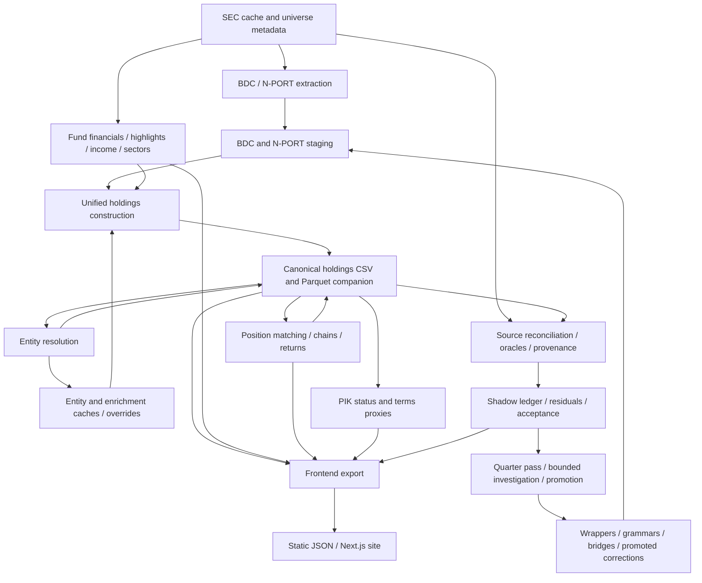

# Current architecture

> Note (2026-09-12): the programme documents this file links to were consolidated into five files under `docs/production_stack/` (`01_decisions.md` to `05_plan.md`). Links below now point at the consolidated document that absorbed each source; dated observations in this file are unchanged.

Assessed 2026-09-09 against working tree at HEAD `2e0491a45d1493e7a3ee329aee52ec96bb34986c`. This describes observed implementation, including uncommitted work; HEAD alone does not reproduce it. It is not a target architecture or release attestation.

Companion: [current-state assessment](../production_stack/05_plan.md). [Source inventory](architecture_source_inventory.csv) records 500 Python files and hashes; [rule/config asset inventory](architecture_rule_assets.csv) records 534 assets and conditional loader dispositions. File counts do not establish active rule counts. Critical execution paths were inspected; every function was not audited.

Later same-day [rule-authority assessment](../production_stack/03_pipeline_design.md): 77 semantic families, 740 assets (including 201 existing HTML templates and five retired overrides), 14 lookup/control inputs and ten isolated runtime replays. Use its retained input identity and loader counts for rule work. It extends the initial inventories without claiming full cohort selector/application coverage.

Target design: [programme data model](../production_stack/02_data_contract.md), [processing architecture](../production_stack/03_pipeline_design.md), [physical design](../production_stack/03_pipeline_design.md) and [implementation plan](../production_stack/05_plan.md). These specify proposed replacement boundaries and execution packages; the observations below continue to describe the assessed implementation.

Later same-day [specification closeout](../production_stack/05_plan.md): a frozen cached rebuild reproduced the exact 780,425-row holdings CSV; fresh identity/PIK consumers, B2 population effects, source/reference dispositions, durable-ID/restore prototypes and browser citation checks are retained. `scripts/programme_closeout/` is preparation tooling, not a new production pipeline. Full source accuracy and final product acceptance remain FAIL/UNASSESSABLE against the numerical proposal.

**2026-09-10 implementation extension:** [`pipeline/programme/`](../../pipeline/programme/) now provides a separate, isolated candidate runner for the existing unified-holdings, entity/position-matching and PIK stages. It freezes code, cached inputs and the physical Python environment; runs native write-boundary and representative-workload checks; and verifies typed artifacts and parent dependencies before recording a completed stage. Candidate outputs stay under `data/programme/candidates/`; there is no production-adoption operation. This wraps the existing transformations and preserves their semantics. It does not implement the target schema, dbt writer graph, stable production identifiers or public citation viewer. See the [runner guide](../production_stack/03_pipeline_design.md) for its precise boundary and the [dated handoff](../production_stack/05_plan.md) for execution and verification status.

## Product boundary and authority

The public v1 is position-level holdings and portfolio analytics for the authoritative approximately 70-BDC wrapper cohort. Distinct debt tranches, equity, warrants and fund interests remain distinct positions. Borrower aggregation belongs to explicitly named exposure analytics. Public indices, interval funds and tender-offer funds are outside this boundary even though backend processing and legacy index artifacts remain.

The cohort authority is `data/overrides/wrapper_cohorts/v2_70_gate_verified_wrapper_manifest.json`, currently 70 CIKs. The broader discovered universe is not the public cohort. Current listing status and cohort eligibility were not independently reclassified in this assessment.

`data/output/private_markets_holdings.csv` is the canonical holdings artifact. Public headline FV and instrument/industry breakdowns are required to sum the same current-quarter cohort holdings across all classifications, without overlays, scaling or deduplication. The implementation currently conflicts with this contract; see the assessment.

Subsidiary/JV rows are retained and flagged; conservation checks have a narrower subsidiary-aware basis. Published FV, conservation FV and verified FV are distinct denominators. Raw comparative facts can represent legitimate prior periods, even where current staging deliberately selects current-period rows.

## Runtime map

This is a dependency map, not a guaranteed execution DAG. Several stages consume saved artifacts from earlier runs. Multiple stages rewrite holdings. Export is not automatically blocked by a failed quarter gate. Arrows into validation do not imply independence from shared parsing helpers.

## Entrypoints and orchestration

| Entrypoint | Actual responsibility and limits |
|---|---|
| [pipeline/main.py](../../pipeline/main.py) | CLI discovery, extraction, construction and optional downstream stages. Some early-return validation/export paths are cached. Normal discovery/extraction can use EDGAR. Several stage exceptions are logged and processing continues. |
| [scripts/rebuild_outputs.py](../../scripts/rebuild_outputs.py) | Rebuilds from cached SEC inputs. Broad order includes extraction, unified, entities, income, financials, derivatives, matching/returns, match quality, PIK and frontend. Optional modes are not a single complete product DAG. Cached SEC operation does not guarantee no model/network calls: GICS cache misses can invoke configured enrichment. |
| [scripts/run_quarter_pass.py](../../scripts/run_quarter_pass.py) | Persistent staged remediation orchestration: preflight/input pinning, rebuild, reconciliation/oracles, validation, provenance, shadow, residual accounting and acceptance/selection. A measured FAIL is a valid result, not necessarily a failed process. Dispatch/promotion has a separate operator boundary. |
| [pipeline/quarter_acceptance.py](../../pipeline/quarter_acceptance.py) | Evaluates data-driven quarter thresholds. It is not a universal publication transaction. |
| [scripts/reattest_quarters.py](../../scripts/reattest_quarters.py) | Records/rechecks signed-off quarters. Regressions require stop-and-report. |
| [pipeline/db.py](../../pipeline/db.py) | Optional database loading infrastructure; not the serving dependency of the static frontend. |

There is no production dbt or Dagster DAG. The [dbt spike](../../spikes/dbt_roundtrip/) demonstrates a narrow round trip; the [production stack plan](../production_stack/05_plan.md) describes planned migration. Eleven typed Parquet companions exist, but the transition is already mixed: staging preferentially reads extracted Parquet, while most downstream readers still use CSV.

## Discovery, extraction and independent fund facts

Discovery combines SEC vehicle information and reference/third-party universe data. N-PORT, N-CEN, N-CSR and tender-offer processing remain shared backend capabilities; public filtering must occur separately. EDGAR access goes through the existing client/cache/rate-limit mechanisms. Assessment did not invoke them.

BDC extraction in [bdc_filings.py](../../pipeline/bdc_filings.py) reads filing concepts, contexts, dimensions and units. Raw identifiers and source references are carried forward, including `src_context_id` and `src_facts`. Extraction is already more than a generic tag lookup: it includes dimensional deduplication and filer-specific handling. Raw facts and normalized holdings must remain separately inspectable.

Fund-level financials, fund income, highlights, fees, derivatives and reported sector subtotals are separate products. They supply analytics, denominator checks and reconciliation targets. They are not interchangeable with sums of extracted positions. Financials combine multiple cached sources; highlights have their own wrapper/oracle machinery. The highlights-wrapper directory currently contains no configurations, so framework existence is not cohort coverage.

HTML and inline-XBRL infrastructure already supplies useful citation anchors. The HTML bridge identifies CIK, accession, date, raw identifier, HTML hash, table, row and cells. Field-status extraction records inline-XBRL coverage/overlays. These are extraction evidence, not an implemented PDF viewer or universal passage locator. PDF page coordinates cannot be inferred from an HTML table index without a mapping step.

## Holdings construction and ordering

Primary sources: [staging_bdc.py](../../pipeline/staging_bdc.py), [staging_nport.py](../../pipeline/staging_nport.py), [unified_holdings.py](../../pipeline/unified_holdings.py).

Observed BDC staging combines:

1. Raw exclusions, wrapper rules and per-CIK identifier parsing. Agent A's grammar overlay is diagnostic; saved identifier spread corrections have a separate production path.
2. Aggregate/header classification, including tracked overrides and generated artifacts used as inputs.
3. Current-period/date selection, normalization of values, currencies and rate-related fields.
4. HTML/inline-XBRL overlays and promoted identifier corrections.

Unified construction then combines source staging, within/cross-source deduplication, vehicle/instrument/exposure classification, subsidiary flags, prior entity lookup, identifier lookup, temporal classification stabilization, denominator adjustments, manual corrections, fund-strategy feedback, promoted B2 and investigation corrections, enrichment caches and position/row keys. Ordering matters: late overlays can supersede earlier classification decisions.

The current broad rebuild constructs unified holdings before rebuilding consolidated financials. Consequently some financial/strategy dependencies can be from the preceding run. Quarter-pass input pinning addresses particular feedback inputs; it does not make every dependency versioned.

The [88-column crosswalk](unified_holdings_contract_crosswalk.md) is the detailed starting point for field ownership and discrepancies. `_enforce_schema` logs warnings rather than imposing a complete blocking financial contract. Typed [output schemas](../../pipeline/output_schemas.py) constrain companion shape/types; this is different from asserting economic meaning, units, eligibility and evidence.

Critical semantics to retain:

- The decided all-in `interest_rate` convention has not been fully migrated: storage currently carries the cash leg. The storage and return-income formula must change atomically.
- PIK terms, strict current PIK accrual/payment evidence and stressed amendments are separate concepts.
- A `row_id` anchors a source/output row; it is not an economic instrument identifier across quarters.
- `position_key`, `position_id`, `entity_id`, raw filing identifiers and source context identifiers have different scopes.
- Comparative-period rows must not be globally dropped as duplicates or globally admitted without accession/period selection.

## Rules, overrides and enrichment are first-class dependencies

The rule surface is distributed across Python, DuckDB SQL, wrapper JSON, per-CIK grammar/anchor configuration, promoted corrections and generated lookup caches. Moving only SQL into dbt would leave much of the actual business logic outside the migration inventory.

| Family | Observed assets / activation qualification |
|---|---|
| BDC wrappers | 78 JSON files, including 77 v3 wrappers and a reference asset; not identical to the 70-CIK public manifest. |
| Identifier dialects | 70 rate grammars, 69 anchors, 42 rate-convention configurations. |
| HTML bridges | One configured bridge; reusable code is broader than configured coverage. |
| Promoted anchor corrections | 67 JSON files; loader requirements can exclude files, so presence is not proof of application. |
| B2 corrections | 39 JSON files among 40 assets; 38 dictionary leaves load through the one-level pattern. Runtime loader does not invoke the correction schema validator; the separate assessment found those 38 schema-valid. |
| Investigation corrections | 144 JSON files including pulled/retired material; application is narrower than recursive file count. |
| Other controls | Manual corrections, aggregate flags, cohort manifest, enforcement rules, thresholds, strategy inputs, position registry and enrichment caches. |

The [initial asset inventory](architecture_rule_assets.csv) records paths, hashes, loader/stage and disposition. The later [authority register](../production_stack/programme_rule_evidence_2026-09-09/run1/rule_authority_register.csv) maps global, wrapper and cache families and links them to target packages. Effective rule instances, units, supersession and full candidate selector overlaps still need certification.

Promoted corrections have evidence/verification/application audit machinery. Raw anchor, B2 and Layer C paths are distinct. Worker proposals are not authoritative merely because an agent produced them. Some runtime loaders trust promoted placement and schema rather than rerunning the full promotion verification at every read. Drift monitoring and regression checks therefore matter.

The bounded replays demonstrate different B2 production/verifier ordering, proposed-file admission, missing B2-only audit, continued CSV writing after a correction error, separate trial dispatch/staging resolvers, and whole-column company GICS replacement. Empty-input builds can omit the Parquet companion; isolated-path companions require explicit strict schema enforcement. See the assessment for fixtures, negative controls and the distinction between these mechanisms and unmeasured production impact.

### Entity resolution

[entity_resolution.py](../../pipeline/entity_resolution.py) builds name/source variants across filers and dates, using normalized names, blocked fuzzy matching, structured identifiers, cross-source matching and override support. The output records a clustering method. It is not a versioned, temporally effective legal-entity graph with independently calibrated link probabilities.

Entity numbers are allocated anew on rebuild; `entity_id` should not be treated as a stable cross-build external key. The lookup is reused during unified construction, and a later entity stage rewrites the holdings CSV. Name cleaning can use the identifier-extraction lookup. This creates both ordering dependencies and potential future-information effects when historical outputs are reconstructed using a later global cache.

### GICS and other inferred values

[gics_classification.py](../../pipeline/gics_classification.py) combines reported industry interpretation, keyword rules and model classification. [gics_mapping.py](../../pipeline/gics_mapping.py) separately maps industry labels through exact/alias/fuzzy/model routes. Company and label caches are different dependencies.

The company cache stores normalized name, sub-industry, confidence, source and timestamp. It does not provide a complete model/prompt/taxonomy/input/evidence version for each decision. Saving the cache refreshes timestamps across saved entries, so the timestamp is not a reliable original decision date. Holdings application does not propagate the full cache decision record into field-level lineage. Late fund-specific remaps also exist.

[gics_quality_gate.py](../../scripts/gics_quality_gate.py) and campaign review/quarantine artifacts already exist. They are not wired as a universal main/rebuild/export gate. The review cache for unclassified instruments carries explicit review evidence; it should be preserved. The configured lien cache is absent in this snapshot, although application support exists.

Reported labels mapped to a taxonomy, model-inferred industries and explicitly reported GICS codes require distinct evidence records. A filing can support the business description used by an inference without explicitly supporting the resulting code.

## Matching, chains and return analytics

[position_matching.py](../../pipeline/position_matching.py) implements comparative-period, structured-identifier, exact/normalized-name, fuzzy and entity/fingerprint routes. It uses one-to-one assignment; contested assignment with a maturity veto is enabled by production entrypoints even though the function default remains false. Supplementary chain construction and edge auditing follow pair matching.

The stable [position registry](../../pipeline/position_id_registry.py) is opt-in, not the default production contract. Raw position numbers renumber across rebuilds. Match override support exists but no active override directory was found. Gap-quarter matching is not enabled by default. Matching within a filer across periods is not equivalent to identifying the same tranche across different filers.

Gold-set tooling, review packets, precision/recall scoring, zero-FV investigations and continuation/chain-completeness work exist. Their saved results must be tied to the exact matcher and input snapshot. Historical adjudications and a single adjudicator are not independently certified truth. Current saved holdings have no populated Q1-2026 `position_id`, despite saved match/return artifacts existing.

[index_returns.py](../../pipeline/index_returns.py) still supplies backend position return/income calculations. Legacy index outputs do not authorize a public index product. Return-dependent fund analytics can depend on these modules even after public index pages were removed.

## Validation, provenance and remediation

There are several substantial layers, not a missing validation subsystem:

- Holdings/column/financial validations and rule registries distinguish stronger evidence from weak plausibility flags.
- Source reconciliation compares published holdings with raw/source schedules; wrapper, fund-highlight and nonaccrual oracles provide additional targets.
- [provenance_reverify.py](../../pipeline/provenance_reverify.py) verifies numeric fields using saved facts and raw XML. Its active ledger is `data/output/provenance_ledger.csv`. The absence of the separate optional `data/output/provenance/` directory does not mean provenance is absent.
- Shadow conservation, identity, cross-source and weaker engines emit `data/output/shadow/validation_results_ledger.csv`; enforcement/disposition controls determine how evidence affects quality tiers.
- Residual classification, investigation queues, correction verification, promotion and application audits support bounded remediation.
- Quarter acceptance and signed-quarter reattestation provide product-level controls beyond individual tests.

Source reconciliation shares some parsing/wrapper helpers with construction. It is valuable but not completely independent of transformation defects. A raw numeric match proves neither position-list completeness nor freedom from duplicate/subtotal inclusion. GICS, entity links and temporal position links are outside the eight-field numeric provenance check.

The active saved gate is provisional v3 on a published basis with nine checks: fund coverage, reconciliation rate, flagged FV, source-blocking FV, verified FV, promoted-rule drift, promoted-rule health, over-inclusion FV and unfinished investigations. Historical v2 signoffs are not v3 passes. Thresholds live in `data/reference/quarter_acceptance_thresholds.json`.

## Serving and citations

[export_frontend.py](../../pipeline/export_frontend.py) and export helpers generate static JSON; [frontend data access](../../frontend/src/lib/data.ts) reads it. Dependencies declare Next.js 15, React 19, Tailwind 3 and Recharts 2; the older Next.js 14 description is stale.

`export_all()` writes artifacts sequentially. Individual atomic file writes do not provide an atomic, gate-approved release bundle. There is no enforced common run/input/schema identifier across every served artifact.

The homepage uses `portfolio_characteristics.portfolioFv` before its fallback. The industry export can use reconciled sector overlays scaled to holdings, and the instrument donut reconstructs categories using layered lien percentages. These are implementation-contract conflicts with the required direct same-holdings aggregation.

The existing fund holdings surface exports the latest positive-FV top 20, not the full historical position schedule. Its row payload omits source/row/entity/position keys needed for reliable citation navigation. The filings tab provides a general SEC filer link. No inline PDF citation viewer was found. Data-quality UI already exists and should be extended, not replaced on the premise that quality reporting is absent.

For the requested click-through, the missing end-to-end contract is: displayed metric -> contributing rows/calculation -> reported or inferred field evidence -> exact source document/version -> passage or page anchor. Aggregates and inferences may need several evidence items. Existing XBRL and HTML anchors are useful inputs; PDF availability, licensing/access and HTML-to-PDF mapping were not inventoried.

## Persistence, operations and tests

The quarter-pass directory persists stage state, logs, gates and selected packets. Worker dispatch uses isolated homes, bounded concurrency and explicit promotion boundaries; see [dispatch reference](codex_worker_dispatch.md). The worker runner normally harvests traces and removes resumable session state during cleanup. `-NoCleanup` exists, but continuation across a provider usage-window interruption was not exercised. Provider quota behavior is not established by this repository inspection.

A durable programme needs task state and evidence outside a model conversation: pinned inputs, branch/commit and working diff, packet specification, bounded attempts, acceptance results and resumable stage ownership. Trace retention alone is not a restart contract.

The active baseline and signed-quarter records are separate governance artifacts. R2 backup tooling exists; remote configuration/completeness was not verified. No remote operations were performed.

The static inventory finds 143 test files and 4,998 test functions, not collected parametrized test cases. CI runs the cache-free subset and frontend build; local cache-dependent checks remain necessary. Pytest guards block ordinary writes to production output roots and detect native-I/O changes after execution. Documentation-only assessment did not execute tests, rebuilds, exports, baseline diffs or reattestation.

**Execution finding, 2026-09-10:** investigation `prep()` also calls `agent_data_query.describe()` to prewarm per-CIK Parquet caches. That module has its own `_CACHE_DIR`, derived from `config.OUTPUT_DIR` at import, and writes through native DuckDB before its query session disables external access. Patching the investigation output directory alone does not redirect these writes. Full-suite verification created six empty test caches under the protected production root; its outer controller detected them after the suite timed out. A global temporary-cache fixture and isolated orchestration sources passed all 54 query/orchestration tests in a subsequent bounded investigation. The diagnostic controller now adds preventive native isolation, append-only progress and worker/JUnit outcome checks; the older full-suite harness still needs this integration. See the [verification investigation](../production_stack/05_plan.md). The incident and scope of preservation checks are recorded in the [tranche handoff](../production_stack/05_plan.md).

## Maintenance

The subsequent 2026-09-09
[contract-resolution trace](../production_stack/03_pipeline_design.md)
details the actual staging/unified/post-unified execution order and consumer
boundaries. It identifies the post-normalization decimal spread override,
verifier/production B2 ordering difference, warning-only pre-overlay schema check,
B2-only audit condition gap, loader-eligible proposed bridge and CSV-only late
identity writes. See its dated assessment for current scope and limits; no
architecture or pipeline code was changed by that trace.

Update this map when module ownership, execution order, canonical artifacts, rule precedence or serving contracts change. Put volatile measured counts and failures in dated assessments. Append architectural decisions and validation results to the agent changelog. Keep planned components explicitly labelled planned until a production entrypoint and verified artifacts demonstrate activation.
